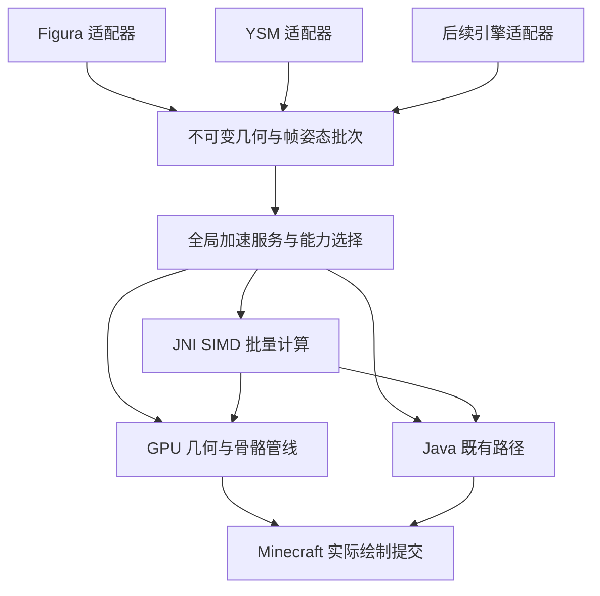

# SIMD 与 GPU 加速支持计划书

> 日期：2026-10-17（Asia/Seoul）。状态：方案交付，H0～H8 均待实施。
> 本次交付为参考核查、实施计划及主 README 参考链接；本文中的新接口、任务、脚本和设置均为拟新增内容，不表示加速功能已实现。
> 当前基线：`AIH-Interactive/omni-morph`，`main`，`2bf3a3dc6f5cc5d0d82eb3abb90a86c0d78944b3`；Minecraft 26.1.2 / Fabric / JDK 25。

## 1. 目标与范围

建立 OmniMorph 全局公共加速层，让 Figura、YSM 及以后接入的模型引擎共享 SIMD 批量计算和 GPU 绘制能力。加速开关属于客户端全局设置，作用于所有玩家、本地模型、远端模型、第一人称、附件及预览，不由模型作者或服务器强制开启。

必须交付：

1. 既有设置页面新增“硬件加速 / Hardware Acceleration”分类，主开关默认关闭，旧配置缺少字段也视为关闭。
2. 用户开启后检测当前进程架构、native ABI、CPU 指令集、图形设备与实际管线；不支持或初始化失败时，在聊天框说明原因并回退 Java 渲染，模型继续可见。
3. SIMD 和 GPU 都有实际工作负载，不能只增加探测开关、空 JNI 调用、缓存统计或未被最终画面使用的 shader。
4. Figura 与 YSM 都通过同一公共接口受益；后续引擎只需提供标准几何、姿态和材质语义，不需重复实现平台探测、DLL 加载和回退状态机。
5. 一个客户端 workflow 按“Linux 编译模组 → 各平台 native → 合并并验证最终 JAR → 上传”组织。26.1.2 仍只编译 Fabric；后端 workflow 不受影响。
6. 本地只编译和运行 Windows native；其他平台在对应 CI runner 构建及验证。发布 JAR 内置平台库，用户无需另装 CMake、编译器或下载 DLL。
7. 保留 Java 路径的模型语义、权限与复杂度、加载代次、异常保留旧模型、多人状态和 Lua + Molang 联动行为。

本计划不修改网络协议、模型格式、后端、解密算法或 Lua/Molang 语言；不把脚本执行迁到 GPU，不引入 CUDA/OpenCL 厂商依赖，不在此时移植其他 Minecraft 版本。现有版本保持 `1.0.0-alpha.1`。

## 2. 依据与当前接入点

参考项目必须区分源码事实、上游描述和本项目的设计选择，详细记录见 [参考核查](SIMD与GPU加速参考核查.md)。固定快照用于复现，不自动跟随上游主分支。

| 参考 | 本地快照 | 用途 |
| --- | --- | --- |
| [Sparkle-Morpher](https://github.com/sdf123098/Sparkle-Morpher) | `fbee58d985cb730d19dd65ea796d5f8ac6f003dc`，`refs/Sparkle-Morpher` | 原生计算、GPU 蒙皮/提交、Minecraft 管线兼容、运行期选择与资源释放的实现对照 |
| [openysm.cpp](https://github.com/OpenYSMDev/openysm.cpp) | `3e86bb01b370ecf225d8d89442e6089840f999c5`，`refs/openysm_cpp` | SIMD/批处理、数据布局、平台构建及边界设计的实现对照；具体能力以核查报告为准 |

核查结论：openysm.cpp 的 `dllmain.cpp` 有实际 SIMD、骨骼/顶点计算和 GPU 网格的 CPU 侧构建；不能把它称为直接执行 GPU draw 的库。Sparkle-Morpher 的 `GpuRenderPath` 执行 `glDrawElements`，`bone_skin.vsh` 以 SSBO 提供骨骼数据并做顶点蒙皮，该路线不是 compute shader 或 transform feedback。Sparkle 所用 native fork 与本地原始 openysm.cpp 快照也不相同，实施时不能混为同一个 ABI。

上游 x64 native 的整库高 ISA 编译及加载期探测存在安全分派上的局限，不能作为本项目低端 CPU 回退可靠性的依据；本计划使用基线入口与独立 ISA 内核，验收需覆盖整条加载链。两项目根许可证为 MIT，但第三方文件/资源仍需单独核查和随包保留声明，详见参考核查。

必须在主 README 的“参考项目与致谢”加入：`openysm.cpp：https://github.com/OpenYSMDev/openysm.cpp`。原 Figura README 备份保持不变。

当前仓库的实际接入点：

| 位置 | 已有行为与改造边界 |
| --- | --- |
| `model/rendering/ImmediateFiguraRenderer.java` | `pushFaces` / `pushToBuffer` 逐顶点处理位置、法线、UV、材质层和可选骨骼权重；保留其 Java 实现作为对照及回退 |
| `model/ysm/YsmRenderer.java` | `render` / `renderCube` / `vertex` 经 PoseStack 与 VertexConsumer 提交；可见面统计已经接入 Avatar 复杂度 |
| `model/ysm/YsmRenderPose.java` | 已有姿态捕获与延迟提交语义；加速批次必须携带同代次不可变快照 |
| `avatar/Avatar.java` / `UserData.java` | 两引擎的所有权、加载和最终发布入口；切换后不能继续提交旧模型的 GPU 命令 |
| `config/Configs.java` / `ConfigType.java` | 已有 Category、BoolConfig、EnumConfig 和设置持久化；新增分类复用原控件、保存及撤销行为 |
| `.github/workflows/fabric-build.yml` | 当前 Linux / JDK 25 只构建 Fabric 并上传成品；实施时扩展本文件，避免两个 workflow 产出相互混淆的 JAR |

上述两个渲染器当前都经过 Minecraft 图形系统；“Java 渲染”在本文指原有 Java 计算和原生提交路径，不代表完全不用显卡。GPU 加速指将额外的逐顶点变换/蒙皮移至 shader，并让最终绘制直接消费该结果。

## 3. 公共架构与引擎合同

拟在 `top.aihmc.omnimorph.render.acceleration` 建立公共边界，native 源码放入根目录 `native/`。名字是实施建议，实际提交需保持职责清晰。



拟提供的合同：

- `AccelerationService`：全局配置、有效模式、能力报告、通知去重、资源代次、失败熔断；不包含 YSM 专属分支。
- `AccelerationBackend`：Java、Native SIMD、GPU 三种后端，声明支持的操作及批次限制；不能仅凭引擎名称宣告兼容。
- `EngineAccelerationAdapter`：由引擎导出稳定拓扑、顶点属性、权重/刚性骨骼关联、最终姿态、材质/顺序信息及失效事件。新增引擎通过同一合同测试即可注册，不要求先创建虚假的第三个引擎。
- `MeshHandle` / `PoseSnapshot` / `DrawBatch`：分别持有静态几何、当前帧只读姿态和绘制语义；均带 Avatar 代次、资源代次、帧/视图及所有权标识。
- `CapabilityReport` / `FallbackReason`：结构化结果，区分平台库缺失、指令集不足、JNI 受限、设备/管线不支持、shader 编译失败、预算不足和运行故障。

标准批次必须表达：索引/四边形面边界、位置、法线、UV、颜色/透明度、刚性骨骼或多权重、位置/法线/UV 矩阵、纹理与材质层、光照/覆盖、轮廓、可见性、镜像/负缩放、通道排序及复杂度成本。不能为了公共接口丢失现有语义。

Lua 回调、Molang 求值、控制器和 CPU 可查询的部件世界矩阵仍按原顺序执行。仅在语义计算完成后捕获只读批次；脚本修改顶点、权重、材质或层级时，通过相应脏标记更新缓存。动态模型也必须能刷新后再次进入加速路径，不能永久禁用所有带脚本的模型。

既有复杂度规则由引擎适配器在路由前计算并保留：Figura 维持自己的预算/裁剪，YSM 维持现有实际可见面统计；一个批次走哪种后端都不能少计、重复计费或擅自改变 YSM 裁剪规则。

## 4. SIMD 与 native 实施方案

采用 C++17 + CMake + JNI 批量接口，先实现骨骼矩阵/位置变换及蒙皮等共同热路径。Java 控制生命周期和渲染语义，native 只执行明确的数值计算；不用每顶点一次 JNI，也不把整个 YSM 解密/解析器顺便改写为 C++。

1. 基线标量内核用于数值对照和安全探测；x86_64 增加 SSE2 / AVX2 分派，arm64 增加 NEON。AVX2/FMA 作为分别检查的能力，不能假设 AVX2 等于 FMA。
2. x86 入口必须先检查 CPUID、OSXSAVE 与 XGETBV 所需状态，再进入 AVX 内核。高指令集代码使用独立编译单元或可靠的目标分派，禁止全库 `-march=native` / `/arch:AVX2` 导致探测前执行非法指令。
3. float 数据用于最终图形批次；CPU 脚本与部件查询保留既有精度。明确矩阵布局、乘法顺序、齐次分量和权重归一化；非均匀缩放与法线矩阵不得复用位置变换冒充正确实现。
4. 连续 DirectByteBuffer / 平坦数组表达批次，ABI 固定宽度类型；校验 capacity、offset、stride、顶点/骨骼数及乘法溢出。拒绝负数、越界、失效句柄和非法权重；不能把用户模型数据当成可信内存地址。
5. 输入只读，输出写入本次拥有的缓冲区，成功后发布；失败不覆盖有效批次。定义空批次、奇数尾部、未对齐、NaN/Inf 与退化矩阵的统一行为，FMA/fast-math 不得默默改变语义。
6. 单次调用有界，避免长期 pin Java 堆或跨 JNI 保存临时引用。CPU 工作可在现有准备线程/受控工作线程执行；JNI 中不得发起 GL 调用或访问 Minecraft 对象。

原生库只从 JAR 内受控清单提取到版本 + ABI + 内容哈希命名的缓存目录，原子写入、校验 SHA-256、绝对路径加载。按 JVM 进程架构而非仅操作系统架构选库；不匹配时回退，不搜索模型包或当前目录中的同名 DLL。

拟加入 `natives/manifest.json`，每项记录平台、架构、库路径、ABI、源码提交、构建工具链、最低系统/运行库、哈希及依赖。Java 与 native 双向握手检查 ABI；不同版本 DLL 不原地覆盖，Windows 占用文件等待后续清理，不强行卸载仍被 JVM 使用的库。

JDK 25 对 native 访问存在限制，需在开发启动和发行环境核对实际策略；拒绝访问时必须给出明确回退原因。不可假设嵌套模组 JAR 的 manifest 能代替启动器参数，或擅自修改用户启动器。[Oracle JDK 25 native 访问说明](https://docs.oracle.com/en/java/javase/25/core/restricted-methods.html)

## 5. GPU 路径与兼容性

首个可交付 GPU 路径采用缓存静态网格 + 每帧骨骼/部件矩阵上传 + 顶点 shader 变换/蒙皮，经过当前 Minecraft Blaze3D / RenderPipeline 及延迟提交边界消费。GPU 可由 Java 调用现有图形接口，native 负责 SIMD；两者无需人为绑定在同一个 DLL 内。

必须验证当前 26.1.2 的实际 GpuDevice、顶点格式、uniform/纹理缓冲限制与排序接口，再选择矩阵承载方式；优先使用正式接口。确需 OpenGL 专用接口时，限定为显式能力分支并隔离于设备适配器，不从模型加载线程绕过 Minecraft 管线直接画屏。

- 同一顶点布局支持 YSM 刚性骨骼和 Figura 多骨骼权重；权重数量超过批次上限时做保持语义的分块或 Java 回退，不能截断权重。
- 已变换顶点直接用于最终 draw，不在常规每帧 `glGetBufferSubData` / readback 后再逐顶点提交。否则只能算 GPU 计算实验，不能作为 GPU 绘制验收。
- 保留材质主/副层、透明排序、剔除、光照、轮廓、发光、第一人称、GUI、附件、载具/投射物及子实体的原有通道；不支持的特殊 draw 单独走 Java，已完成的 draw 不重绘。
- CPU 仍维护脚本查询、手持物锚点、头顶加载条和必要世界矩阵；GPU 结果不成为每帧 CPU 查询的同步前提。
- GPU 上传和释放由渲染线程/设备认可的线程执行；姿态捕获线程不访问 GPU。缓冲池有显存/帧内预算、fence/退休机制，模型切换、Reload All、资源重载和离开世界都会使旧句柄失效。
- Shader 编译、链接及管线自检在启用/资源重载时有界进行，状态为“检测中”；本帧仍用 Java，避免首个复杂模型触发长时间同步编译。

Compute shader 不是第一版的强制门槛。若 H0 证明现有设备接口更适合 compute，则在 H0 记录选择和同步/barrier 合同后采用；没有 compute 不等于没有顶点 shader 能力。Khronos 的 compute 与 SSBO 是分别定义的能力，不能只检测显卡品牌或一个版本字符串。[Compute 规范](https://raw.githubusercontent.com/KhronosGroup/OpenGL-Registry/main/extensions/ARB/ARB_compute_shader.txt)、[SSBO 规范](https://raw.githubusercontent.com/KhronosGroup/OpenGL-Registry/main/extensions/ARB/ARB_shader_storage_buffer_object.txt)

Sodium、Iris/光影、不同图形后端分别列入能力与画面矩阵。无兼容实现时明确回退，不强行替换 shader，不以关闭用户光影或破坏其他模组状态换取加速。macOS native 编译成功也不代表 GPU 分支可用。

## 6. 硬件加速设置、通知与回退

在既有 ConfigScreen 增加同级分类，复用原有控件，不增加独立 YSM 页面。中英文键统一用 `config.hardware_acceleration...`，技术名称如 Figura Lua API 不做品牌替换。

| 项目 | 默认值 | 行为 |
| --- | --- | --- |
| 启用硬件加速 | `false` | 唯一全局主开关；关闭时不主动加载本项目新增 native、不创建加速 GPU 资源 |
| 加速方式 | 自动 | 可选自动（GPU + 可用 SIMD 计算）、仅 SIMD、GPU；开关关闭时该偏好不生效 |
| 当前状态 | 只读 | 显示实际 Java / SIMD 内核 / GPU、检测中或回退原因，不能只显示用户期望值 |

自动模式优先选择通过完整自检的 GPU 路径，并在共同 CPU 工作中使用可用 SIMD；GPU 无法使用时，按本需求回到完整 Java 路径并提示，不悄悄把 SIMD-only 当作 GPU 成功。用户明确选择“仅 SIMD”才允许在 GPU 不支持的设备上使用该模式；其最终绘制仍通过既有 Java 提交通道。GPU 本身可独立于 SIMD 工作，不因 CPU 没有 AVX2 拒绝 GPU；native 不可用时也不能影响原 Java 路径。

状态机：`DISABLED -> PROBING -> READY / FALLBACK_JAVA`。记录 requested 与 effective 两个状态；启用失败保留用户偏好，但本会话有效路径为 Java。主动重试通过关闭再开启或资源设备重建触发，禁止每帧重试、重复加载 native 或刷聊天。

聊天提示要求：

- 例如“[OmniMorph] 硬件加速不可用：当前图形管线不支持，已回退 Java 渲染。”或“原生库与当前进程架构不匹配，已回退 Java 渲染。”原因须准确、本地化。
- 从设置启用且已进世界时立即在主线程发聊天；标题界面没有玩家时暂存一条，进入世界后发送，不能只写日志/Toast 代替聊天要求。
- 同一会话、模式和原因去重；切换模型不重复刷屏。详细能力及失败日志只在首次/状态变化记录，不输出模型明文。
- 应用设置才触发探测，撤销临时编辑不加载库；关闭后在帧边界停止新加速提交并安全退休资源，不清空当前 Avatar。

运行故障先停止对应后端的新批次，再在可靠边界切回 Java，保持上一个有效模型或皮肤。发生在 draw 之前可安全重路由同一批次；部分 draw 已提交后只回退剩余未提交批次或下一帧，避免重复叠画。资源耗尽和不支持的材质按有限范围回退，不让一个模型反复触发全局错误。

`UnsatisfiedLinkError`、ABI/能力拒绝等可控错误可回退；native 访问违例、非法 CPU 指令或进程级驱动崩溃无法靠 Java catch 保证恢复。因此必须靠加载前检查、内存边界测试和能力白名单预防，不能承诺从进程崩溃中无损回退。

## 7. 支持平台与单工作流打包

初始 native 发布矩阵如下。它表示必须产出和验证的库，并非预先宣称所有平台 GPU 通过。

| 平台 ID | runner 建议 | 产物 | 必须验证 |
| --- | --- | --- | --- |
| `windows-x86_64` | `windows-2022` | `omnimorph_accel.dll` | MSVC x64、Java 25 JNI 加载、标量/SSE2 与可用 AVX2、依赖清单 |
| `linux-x86_64` | `ubuntu-22.04` | `libomnimorph_accel.so` | glibc 基线、动态依赖、Java JNI、当前 CPU 可用内核 |
| `macos-x86_64` | `macos-15-intel` | `libomnimorph_accel.dylib` | 实际 x64、最低系统版本、安装名/依赖、JNI；GPU 另验 |
| `macos-aarch64` | `macos-14` | `libomnimorph_accel.dylib` | 实际 arm64、NEON、最低系统版本、JNI；GPU 另验 |

runner 标签按编写时的 [GitHub 官方列表](https://docs.github.com/en/actions/reference/runners/github-hosted-runners) 核对，实施时再次确认可用性，不依赖 `macos-latest` 暗示架构。Windows/Linux arm64 及 32 位不列为首版 native 支持，仍可运行 Java；后续新增平台沿用同一 ABI 和打包合同。

Linux native 以所选构建基线实际符号版本确定最低 glibc，不用 JAR 构建的 Ubuntu 版本推断；避免意外链接开发机专有库。Windows 明确 CRT 策略，优先自包含且符合许可的静态运行库方案。macOS 校验 deployment target、架构和加载策略，必要签名步骤及其局限记录在产物清单。

扩展现有 `fabric-build.yml`，流水线依赖必须是：

1. **`build-mod`，Linux / JDK 25**：先编译 `:fabric:build`，生成唯一基础成品 JAR、JNI 头/ABI 规格与提交清单，上传内部中间 Artifact；中间 JAR 不作为最终下载入口。
2. **`build-native`，`needs: build-mod`**：四平台原生 runner 矩阵，下载同一次运行的接口产物；锁定源码/依赖，CMake Release 构建、原生单元测试与 JNI 数值差分测试。每项上传库、依赖/许可证、哈希和平台清单；`fail-fast: false` 便于汇总失败。
3. **`assemble`，Linux，`needs: [build-mod, build-native]`**：只下载本次 run / 本次提交的全部产物，验证四平台集合、ABI、提交及哈希，拒绝缺失/重复平台，然后写入 `natives/<platform>/` 和 manifest。
4. **`verify-final`，`needs: assemble`**：四平台分别下载同一最终 JAR，实际从 JAR 解压并加载本平台库跑 JNI smoke；另有无匹配平台/缺库/禁用模式的 Java 回退测试，不假装在一个 runner 执行其他架构 DLL。
5. **`publish-artifact`，`needs: verify-final`**：仅当所有必需任务成功才上传最终全平台 Fabric JAR，提供可点击摘要和 30 天 Artifacts；失败日志保留，任何平台失败不能静默发布缺库的“全平台版”。

新增 Gradle 打包任务应从基础成品复制生成输出，通过 Java ZIP/Jar API 或 Gradle Jar 受控合并，不二次混淆、不丢失原有内嵌依赖/清单/资源，不通过再次执行 remapJar 覆盖已注入产物。验收检查 JAR 条目重复、全部平台库、哈希、许可证、mod ID/version 及实际 JNI 加载。最终文件仍以 `omni-morph-...-fabric-mc.jar` 面向用户，中间文件必须区分目录与名称。

各 job 使用 PowerShell 前台命令及 `2>&1 | Tee-Object -FilePath build.log`，立即保存 `$LASTEXITCODE`，失败读取日志并退出；Linux 的 Gradle 经 `bash ./gradlew` 执行，macOS 安装/使用 PowerShell 的方式须在 CI 明确验证。PR 只构建和上传，不需要发布凭证；工作流最低 `contents: read`，不从不受信任 PR 取代码到高权限任务执行。

普通 hosted runner 的 native 测试和 JAR smoke 不能作为真实 GPU 画面/性能通过证据；这类验收在真实游戏窗口和有图形设备的环境完成。

## 8. 本地 Windows 开发流程

本地不交叉编译 Linux/macOS，不启动其模拟器。拟新增 `tools/build-native-windows.ps1`、CMake preset `windows-x64-release`、Gradle `packageLocalNative` 与 `nativeSmokeTest`；以下是实施后的预期接口，当前不可当作已存在命令执行。

```powershell
. 'D:/UserData/Documents/WindowsPowerShell/Microsoft.PowerShell_profile.ps1'
usejdk 25
& .\tools\build-native-windows.ps1 2>&1 | Tee-Object -FilePath build.log
$buildExitCode = $LASTEXITCODE
Get-Content -LiteralPath build.log -Tail 40
if ($buildExitCode -ne 0) { exit $buildExitCode }

& .\gradlew.bat :fabric:build packageLocalNative nativeSmokeTest --console=plain 2>&1 | Tee-Object -FilePath build.log -Append
$buildExitCode = $LASTEXITCODE
Get-Content -LiteralPath build.log -Tail 40
if ($buildExitCode -ne 0) { exit $buildExitCode }
```

Windows 构建脚本内部按顺序前台执行 configure、build、CTest，每步同样 Tee、立即检查退出码并读日志，不能只检查最后一步。脚本明确导入 MSVC x64 开发环境和 JDK 25 JNI 头，不依赖当前 shell 偶然已有编译器。

本地只注入 `windows-x86_64`，输出到独立 `build/local-native/`，名称带 `windows-local`，清单标记 local，避免覆盖/冒充 CI 的全平台发布 JAR。纯 Java `:fabric:build` 继续可独立运行，不要求用户先装 C++ 工具链。

真实游戏验证先用默认关闭模式，再开启加速测试；若目标 JAR 被占用，等待 Minecraft 释放后覆盖，不中断用户进程或换成不明确的替代发布包。加载中的 native 使用内容哈希路径，避免覆盖已加载 DLL。

## 9. 分阶段实施与验收

H0～H8 必须顺序推进。每阶段按规定验证、更新进度记录、检查 status/diff/diff --check、独立 commit、push 并核对远端 SHA 后，才开始下一阶段。人工项可记录 `MANUAL/PENDING`，不能把未测算作 PASS；与此无关的优化另记跟进，不扩大本阶段范围。

| 阶段 | 交付 | 必需验收 |
| --- | --- | --- |
| H0 基线与技术定案 | 固定参考快照、热点测量、26.1.2 图形 API/材质清单、数据布局、平台 ABI 和 GPU 路线决策 | 实际采样区分动画、顶点计算、上传、draw 与加载；Figura/YSM 基线帧和样本可重放；GPU 路线给出真实接口调用证据，不以文档猜测可用 |
| H1 公共合同与 Java 后端 | 全局服务、适配器、代次/只读批次、Java 对照实现；同时接通 Figura/YSM | 两引擎保持原画面/预算/回调顺序；替换/Reload All/旧帧拒绝；未来适配器合同测试，无生产第三引擎占位 |
| H2 Windows SIMD | native ABI、CMake、探测/分派、批量内核与 Windows 本地脚本 | JNI 真调用；随机/边界/真实样本 Java 差分；无 AVX2、OS 状态不足、未对齐、尾部及越界；验证 JNI 往返成本，不能以“加载 DLL 成功”结束 |
| H3 全局设置和回退 | 原设置分类、默认关闭、实际状态、聊天通知、去重与安全关闭 | 新旧配置默认关闭且不主动加载；撤销不探测；标题界面延迟聊天；不支持/缺库/ABI 拒绝/受限访问均回 Java；实际窗口中英文字与控件验证 |
| H4 公共 GPU 后端 | 设备能力自检、缓存网格、矩阵上传、shader、实际 draw、退休机制 | 真 GPU draw 使用结果；不依赖每帧 CPU readback；强制 shader/资源失败回退；设备重建、超预算、旧代次释放；真实画面数值/视觉对照 |
| H5 双引擎完整接入 | Figura/YSM 常规几何、蒙皮、动态修改、各视角/材质/附件通道 | 两引擎均跑 SIMD/GPU；脚本动态修改后可重新加速；特殊通道回退正确；复杂度、权限、加载提示及多人状态不变，不能只完成 YSM |
| H6 多平台 native 与整合 CI | 四平台库、合并 JAR、清单/依赖/许可和最终 JAR 平台 smoke | 真实四 runner 成功、ABI/哈希及最低运行库核查、最终 JAR 各平台加载；Linux 构建 Fabric；可下载最终 Artifact；故意漏平台阻止发布 |
| H7 稳定性与性能 | 真实语料、模式切换/重载/卸载、内存/显存、兼容矩阵及测量报告 | 本地只构建 Windows；其余平台 CI；性能包含真实 GPU 和 p50/p95/p99，统计 CPU/GPU 时间、JNI/上传开销；压力测试无资源增长，回退不丢模型 |
| H8 最终审计与交付 | README 使用/支持矩阵、进度证据、最终发布 JAR、完整来源/许可证 | 每项需求有文件和日志/画面/产物证据，版本/提交对应；Java 默认、失败聊天回退、双引擎受益、四平台内置和 Windows-only 本地流程逐项复核 |

H0 的微型原型仅用于验证所选 GPU 数据/提交路线，不提前完成后续阶段生产实现。H3 能力尚未就绪时必须如实显示检测失败并 Java 回退，不能提前显示 GPU 成功。

## 10. 验证矩阵与完成标准

### 10.1 正确性与生命周期

- 数值：标量 Java、SIMD、GPU 测试输出对照；刚性/权重、旋转顺序、逆转置法线、负/零缩放、零/非法权重、UV、溢出和尾部。初定位置误差 `abs <= 1e-4 + 1e-5 * abs(reference)`（模型局部单位），法线夹角 `<= 0.1°`；H0 根据坐标范围确认并冻结，不在失败后放宽以刷绿。
- 姿态与画面：真实 Figura、普通/加密 YSM（包括末影龙娘），主体/手臂/附件/GUI/子实体，透明/发光/轮廓和脚本动态顶点。GPU 测试允许专用诊断 readback，生产每帧禁止同步回读；截图用实际游戏窗口，CPU recorder 只证明提交参数。
- 全局性：同屏 Figura 与 YSM 开关同时生效，远端模型也受客户端设置控制；双运行时联动、复杂度、权限、头顶加载条及切换广播不被改变。
- 故障：无匹配平台库、坏哈希、ABI 不匹配、无 SIMD、无合适 GPU、native 访问受限、shader 失败、Iris 不兼容、资源耗尽；检查 Java 真路径、聊天文本/次数及模型可见性。
- 生命周期：连续选择/取消、下载完成后准备、Reload All、世界切换、关闭加速、资源/设备重载；旧批次不能发布，GPU 资源按 fence 释放，JNI 缓冲不悬空，旧模型不会因检测失败消失。

### 10.2 性能与证据边界

同一机器、游戏设置、视角、样本/人数和时长，对比 Java、SIMD、GPU。预热后至少 3 次独立采样，记录原始数据、CPU/GPU/驱动、实际模式、顶点/骨骼/可见面、GC、native 内存和显存，避免只报平均 FPS。

初定目标：CPU 受限复杂场景的模型计算/提交 p95 至少改善 15%，轻量场景总帧 p95 回退不超过 5%；这是待验证的验收目标，不是当前性能承诺。H0 用可重复基线定案，冻结阈值和批次大小；若不达标，调整批处理/路由而非用空调用、删语义或放松阈值宣称通过。小批次低于获益阈值可走 Java，并在诊断中说明，不能因此让所有真实样本都始终回退。

真实 GPU 画面、实机驱动与双客户端视觉验证未执行时标 `MANUAL/PENDING`。CI 跨平台编译和 JNI smoke 证明可构建/可加载，不能证明该平台 GPU 画面或性能。H8 报告分别列自动通过、实机通过和待人工项。

## 11. 来源、许可证与实施记录

优先基于公开算法和既有项目结构自行实现公共层；直接复制参考代码前，逐文件确认实际许可证及第三方依赖，保留要求的声明与源码提供义务。不能因为项目都在 GitHub 就默认允许直接改用本项目 PolyForm Noncommercial 标头；不兼容的部分只做行为对照并独立实现。具体发现见参考核查，实施后把实际采用内容补入 CREDITS/随包 NOTICE。

后续新增 `Plans/SIMD与GPU加速实施进度.md` 记录 H0～H8 每阶段提交、命令、日志位置、实测和人工项。当前计划交付不执行 native 构建、不改现有 workflow 或生产设置，也不把上一轮 Linux Fabric 构建当作本方案的 native/GPU 验收。
