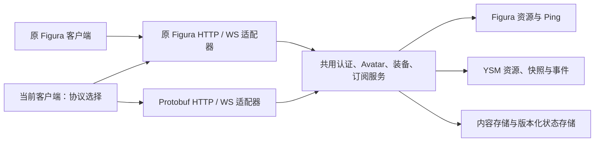

# 后端改造与 Figura/YSM 通用 Protobuf 协议计划书

日期：2026-10-17。状态：计划待执行；本文不代表后端或客户端协议改造已经实现。

客户端核对基线：`b3461a3df71bc85d75ec98084c42f752aca4c7d6`。配套后端：`omnm-cloud`，核对提交 `28fb81ed177bf24ae616eb68e9c6220f0bd60a4a`。后端是独立 Git 仓库，实施时须分别记录客户端与后端提交，不能只提交父仓库文档便宣称后端已交付。

## 1. 目标、边界与最终行为

本计划设计后续实施工作，本次交付为计划书。原 YSM 引擎 M0～M8 已完成，不重开或扩张原里程碑。之前“需要后端修改则记录并跳过”的约束属于原引擎计划；本计划将这些后端需求列为后续明确实施项，不冒充已解决。

| 要求 | 最终行为 | 完成证据 |
| --- | --- | --- |
| 原 Figura 保持兼容 | 原客户端继续使用原 HTTP、WebSocket、Avatar 与 Ping 格式；新客户端可选择同一旧协议 | 旧协议黄金数据、旧客户端对新后端的端到端回归 |
| 新增 YSM 后端实现 | 后端识别 YSM 资源类型、保存原始分发包、提供装配身份与状态同步服务 | 明文/密文上传下载等值、状态恢复与权限测试 |
| Figura/YSM 共用 Protobuf | 认证、用户、资源、装备、订阅、错误与限额共用；模型差异放在有类型扩展内 | Java/Rust 双向协议向量及两种 Avatar 的完整链路 |
| 协议选择 | Figura 原设置界面新增“协议类型”，只有 `Figura Cloud`、`Protobuf` 两项 | 配置持久化、切换隔离和设置界面检查 |
| 默认 Protobuf | 新安装以及没有协议字段的旧配置均选择 `Protobuf`；已有显式选择保留 | 默认值及配置迁移回归 |
| Debug 明文连接 | 仅 `FiguraMod.debugModeEnabled()` 为真时允许显式 `http://`、`ws://`，两种协议均适用 | Debug 开关、端点组合、关闭后的连接撤销测试 |

协议类型与模型类型正交：Figura 模型同样能走 Protobuf；YSM 不是第三种协议选择。保持 Figura 的界面、控件、多语言和预览，不增加 YSM 专用 GUI。单人本地模型加载不依赖后端在线、协议握手成功或云端上传。

用户补充约束：模型上传和分发统一正常走 HTTP/HTTPS，在两种协议模式中均直接传输模型包字节，不经 WebSocket，不把模型文件编码进 Protobuf 信封。Protobuf 负责控制消息与实时状态；HTTP 明文仍遵守第 7 节的 Figura Debug 开关限制。

本计划不包含新渲染器、模型格式重写、商城、浏览器管理后台、第三方模组联动，也不把独立 `spm-cloud` 全部功能合并进当前后端。

## 2. 当前实现与改造落点

以下为本地源码核对事实，不是对远端部署能力的推断。

| 模块 | 当前证据 | 本计划的改造 |
| --- | --- | --- |
| 主后端路由 | `omnm-cloud/src/main.rs` 注册 `/api`、`/ws`、`/internal`；保留 `/api//auth`、`/api//assets` 的历史双斜线 | 保留原入口，新增有版本前缀的 Protobuf 入口；不得顺手规范化旧 URL |
| 静态 Avatar | `src/api/figura/profile.rs` 处理用户资料、装备和 `.moon` 文件；客户端下载压缩 NBT | 新增类型元数据与不可变内容存储，保留旧资源字节与旧 hash 语义 |
| 实时消息 | `src/api/figura/websocket/handler.rs` 按认证 session 转发 Ping，订阅广播不提供历史快照 | 增加与传输格式无关的会话/订阅层及 YSM 快照服务 |
| 额度 | `src/api/figura/info.rs` 公布旧 Ping 大小、频率等额度 | 新协议单独协商可执行的限额；旧额度字段与语义保持 |
| Protobuf 参考 | `omnm-cloud/spm-cloud` 是独立 crate，使用 prost；`proto/spm/cloud/v1/cloud.proto` 已定义 Envelope/Hello 等 | 只读借鉴握手、心跳、生成链与测试方法；它不是主后端现有协议，不能直接宣称 wire 兼容 |
| 客户端网络 | `backend2/NetworkStuff.java` 直接绑定 HttpAPI 与旧 WS handler，YSM 状态通过保留 Ping ID 分片 | 抽取最小协议接口，保留旧适配器，新增 Protobuf 适配器 |
| 端点 | `backend2/HttpAPI.java` 拼接 HTTPS；`backend2/trust/KeyStoreHelper.java` 建立 WS；`Configs.SERVER_IP` 使用 IPConfig | 统一 URI 解析与安全策略，覆盖 HTTP、WS、认证和重连，支持显式 scheme 与 IPv6 |
| Debug | `Configs.DEBUG_MODE` 经 `FiguraMod.debugModeEnabled()` 判断；另有 NetworkStuff.debug 日志标志 | 仅 Figura Debug 开关授权明文连接，日志标志不授予连接权限 |
| YSM 既有同步 | [M7协议决策记录](YSM-M7协议决策记录.md) 定义内容/schema hash、会话、代次、序号、快照及事件水位 | 保留状态语义，在新协议内提供正式类型与服务端恢复能力 |

客户端主要影响 `backend2/`、`config/Configs.java`、既有设置与语言资源、`model/ysm/sync/`、Avatar 上传下载及缓存接线。后端主要影响主 crate 的 `api/`、`auth/`、`state/`，新增 protocol/service/storage 模块和迁移。实际文件名在 B0 冻结，不对不相关模块进行重构。

## 3. 双协议架构与兼容承诺



保留旧 `HttpAPI`/C2S/S2C 的格式实现，迁移到协议适配器后仍发送原字节。新接口以认证、能力、资料、上传/下载/删除、装备、订阅、普通 Ping、YSM 同步为最小边界；`NetworkStuff` 保持调用入口，避免一次改写全部 UI/Lua 调用者。

服务端业务事件先形成内部类型，再由每个连接的适配器编码。禁止将 Protobuf 帧原样发送给旧 WS，也禁止把旧 Ping 外层字节当成 Protobuf 解码。Figura 的普通 Lua Ping 应在两种协议之间按函数 ID、echo 与不透明参数字节等值桥接；同一个订阅事件只能消费一次。事件通知、换装和删除同样跨协议生效。

旧客户端只能渲染其原本认识的 Figura 内容。对仅支持 YSM 的装备，旧资料接口返回无可用 Figura Avatar 的既有表示；不能返回 YSM 字节冒充原 Figura NBT。若用户保留 Figura 兼容装扮，则通过独立的兼容装备记录提供；Protobuf 与新客户端看到真实模型类型。Figura/YSM 装备投影规则、清空/换装通知必须在 B0 固定并测试。

新客户端选择 `Figura Cloud` 时保留现有 YSM NBT 分发与 M7 Ping 扩展；仅在对端客户端支持时有效，不能要求未修改的原 Figura 自动识别 YSM。Protobuf 模式不再叠一层旧 Ping 分片发送 YSM 状态。

同一用户可能同时有多个协议/设备会话。服务端会话按 session ID 管理，禁止旧连接关闭时删除新连接、禁止同 UUID 新连接覆盖另一个传输实例。YSM 写入绑定唯一有效发布代次；旧发布者失去权限，订阅连接可并存。

## 4. Protobuf v1 协议设计

### 4.1 入口、版本与生成

拟新增 `GET /api/protobuf/v1/capabilities`、`POST /api/protobuf/v1/rpc`、`/ws/protobuf/v1` 和有边界的资源上传/下载入口。控制面 HTTP 使用 `application/x-protobuf`，WS 使用二进制消息及子协议 `omnimorph.cloud.v1`。这些为拟定的新入口，不宣称当前已经存在。

以独立发布的协议目录及 `.proto` 为唯一字段定义源，包名拟定 `omnimorph.cloud.v1`。Rust 和 Java 均从相同版本生成代码，固定工具链版本与协议摘要，禁止手写两份字段布局。具体依赖版本在 B0 结合现有 Gradle/Cargo 解析结果冻结，不直接挪用 `spm.cloud.v1` 包名或字段号来假装兼容。

proto3 的字段号发布后不可复用；删除字段与枚举值保留 reserved，零枚举值为 UNSPECIFIED，未知值在业务层受控处理。增量支持未知字段；不兼容升级使用新主版本。字段缺省不自动代表授权、空状态或最新序号。

### 4.2 信封与会话

设计字段如下；B0 必须交付可生成的完整 `.proto`、字段编号和黄金向量，本表不是已编译的 schema。

| 类型 | 必需内容与约束 |
| --- | --- |
| Envelope | 协议主版本、request ID、session ID、connection epoch、有类型 oneof body；未知 body 返回受控错误 |
| Hello / HelloAck | 支持版本、客户端版本、模型能力、服务端能力、实例 ID、限制、心跳参数；无公共版本即终止，不解析业务消息 |
| Auth / AuthResult | 挑战与身份凭证、认证 owner、到期时间；消息 owner 由认证结果派生，不能由请求任意指定 |
| Error | 稳定错误码、可重试标志、本地化 key、request ID；details 不含 token、密钥或解密资源 |
| Ack / Resume | 幂等 operation ID、已提交 revision、会话恢复游标与服务端 epoch；过期游标要求重取快照 |

连接顺序为能力发现、认证、WS 升级和 Hello 协商、订阅/恢复、正常消息。Hello 只协商，不赋予读写权限；认证 token 不放 URL。复用现有 Minecraft 身份验证基础，增加实例/协议作用域和过期管理，不引入第二套账号系统。HTTP 与 WS 的身份、限额和能力必须来自同一有效会话。

一个完整 WS message 对应一个 Envelope；库可重组底层 WS fragments，但在重组/解码前执行总字节上限。HTTP 每个请求/响应一个信封。Protobuf 不是加密协议；正式连接仍使用 HTTPS/WSS。

### 4.3 Figura/YSM 通用资源与业务消息

| 消息组 | 设计内容 |
| --- | --- |
| Profile / Limits / Motd / Version | 对应旧协议现有功能；版本化错误与限额映射，不丢掉 Figura 徽章和权限信息 |
| AvatarDescriptor | owner、asset ID、revision、模型类型 FIGURA/YSM_PLAIN/YSM_ENCRYPTED、分发格式、原始包 hash、长度、内容身份、schema 身份及所需能力 |
| 上传/下载授权与提交元数据 | 仅包含资源描述符、授权、校验及提交结果；模型文件另走普通 HTTP/HTTPS 上传下载 |
| Delete | 校验权限、幂等重试、删除 tombstone；失败上传不可成为可装备资源 |
| Equip / EquippedState | 目标资源与 revision、expected revision；冲突不静默覆盖；一个权威状态向双协议投影 |
| Subscribe / Unsubscribe / AvatarChanged | 授权目标、版本游标、换装/删除通知；事件中使用认证确定的 owner |
| FiguraPing | 保留函数 ID、echo、参数原始 bytes；不反编译或重新编码 Lua 参数 |
| YsmSnapshot / YsmDelta / YsmEvent | 有类型的模型状态、增量和瞬时事件，详见第 5 节 |

资源数据与控制消息分离：Protobuf 描述符和 RPC 管理资源，模型上传和分发均通过普通 HTTP/HTTPS 的 PUT/POST 与 GET 流式传输，模型响应使用原始包的 Content-Type（未细分时为 application/octet-stream），不使用 application/x-protobuf 封装文件。两个协议适配器均调用这一文件传输能力，旧模式保留原上传下载路由及字节格式；新模式在版本化资源路由中传同样的包字节。上传授权、描述符和提交结果可以是 Protobuf，文件请求体/响应体本身不是 Protobuf，也不经 WebSocket。大纹理/声音随模型分发包或其授权 HTTP 资源入口获取，不塞入 WS。

HTTP 文件传输必须保留认证和权限检查、有界流式读写、大小/hash 校验、取消/超时及失败临时文件清理；下载地址只能指向已授权资源，重定向遵守第 7 节。上传完成并校验后才原子发布，不能把“取得上传地址”当作上传成功。Figura 继续保留原压缩 NBT 字节；YSM 使用当前正式输出过滤后的分发包，内部密文源保持原密文。由客户端现有 loader 解码，服务端不执行 Lua/Molang、不解密 YSM、不保存解密密钥。

上传包 hash、解包后的模型内容身份、schema hash 是不同概念，分别记录，不能相互替代。双协议共享同一 Figura 原始资源时保持旧 hash 不变；内部存储键升级不改变旧 API 返回的内容身份。缓存键至少包含实例、owner、资源 revision/hash 与分发格式，避免换服务端、换类型或换协议后误用旧资源。

### 4.4 限额与拒绝策略

新协议初始控制消息上限拟为 64 KiB（含完整编码信封），YSM 单条状态体沿用最多 32 KiB 的语义预算，最终以 B0 冻结的完整消息测试确定。服务端可协商更低值，客户端取本地硬上限与服务端上限的较小值。模型上传上限独立配置，不沿用小控制帧限额，也不得为大模型放开全部 HTTP 请求大小。

同时限制消息频率、总字节速率、嵌套深度、重复字段数量、peer/订阅数量、排队字节、上传并发和过期时间。长度校验在分配前进行，解压执行压缩/解压双重预算。未知枚举、NaN/Infinity、错误索引、越权、序号冲突和超额均有确定错误。慢消费者优先合并可替代状态或要求快照恢复；瞬时事件不静默伪装成已可靠交付。

旧 Figura 的公开额度、线格式与既有合法请求保持；新增连接不能绕过按账户汇总的后端预算。协议切换不能重置计费/限流状态。

## 5. YSM 服务与状态恢复

保留现有 M7 的 owner、session、generation、sequence、baseSequence、ownerTick、content hash、schema hash 和事件水位含义；在 Protobuf 中直接定义有类型字段，不长期把旧 YSMS 整包装进 bytes 冒充完成协议改造。适配器可在迁移期间使用现有状态对象，但新 wire contract 必须独立生成并测试。

快照覆盖纹理、控件、动作、controller/state/time、播放槽及必要同步事件。继续使用模型整数索引，不发送私有骨骼/动画名、函数源码、任意变量对象、纹理/音频或密钥。增量分区使用显式 presence：未提供表示保持，提供空列表表示清空；不能用 proto3 默认空列表同时表达两种含义。

服务器只接受认证 owner 对当前已装备内容、当前发布 session/generation 的写入。客户端应用前再次验证内容/schema、索引、范围与 authority；observer 不反向发布 host 状态，不从自己的输入决定 owner 动画，导入不重放历史 entry/exit、BGM、粒子或短动作。

服务端保存最近有效完整快照和有界增量/事件尾部。仅收到增量不能证明产生了新完整快照；缺少基线、序号断裂、尾部淘汰或恢复失败时请求 owner 补发。首次订阅先快照与水位，再有序增量；重连用游标续传，游标过期则重新基线。旧会话/旧模型消息不可复活已退役状态。

持久化至少包含 owner、资源 revision、session/generation、快照序号/事件水位、schema 版本、写入时间及 TTL。必须验证服务端重启、断电式中断和删除撤销恢复。owner 离线时只能提供未过期的最后已提交静态/逻辑状态，不能凭服务器时钟继续执行模型或重放过期瞬时效果；超时明确返回离线/不可恢复状态。

`ysm.sync`/@sync 保留现有参数与去重语义，后台事件按有限个数和 TTL 保留；同一 owner 通过双协议桥接时仍只触发一次。长时间拥塞后的丢失须报告或重新取快照，不能宣称无界可靠事件队列。

原 M7 的“空载载具历史模型归属”涉及权威世界实体绑定：新协议预留明确 capability，但没有游戏服务器插件/可验证权威来源时不开放写入，记 `AUTHORITY_UNAVAILABLE`。不信任任意客户端自报占有，也不以加入 Protobuf 为由假装解决此项。该依赖独立记录，不阻塞 Avatar 资源、玩家状态和协议选择交付。

## 6. 客户端协议选择与默认值

在原 Figura 设置中复用 EnumConfig 与既有枚举控件，显示 `Figura Cloud`、`Protobuf`，新增中英文语言 key。内部配置使用稳定枚举值而非 UI 下标；若继续复用数字配置序列化，须显式冻结映射与迁移，防止枚举顺序变化。默认值、重置值、缺字段迁移值均为 `Protobuf`。未知配置值回到 Protobuf 并给出已有样式诊断。

保留用户的服务器地址。协议选择只决定适配器和对应路径，不擅自切换域名，也不假设当前默认域名已部署新协议。部署顺序要求先开放 Protobuf 后再发布默认启用的新客户端。对不支持 Protobuf 的旧服务端显示能力不支持及手动选择 Figura Cloud 的提示；不静默降级，不在失败后把认证凭证转发至别的地址。

切换协议或地址时，取消在途请求、结束旧 WS、递增连接 epoch、清空重组和订阅队列、重新认证并订阅。回调捕获 protocol/endpoint/session/epoch，迟到回调不得污染新连接。普通 Figura Ping 和 YSM 使用当前选中连接，不同时发送两份。

服务端资源缓存可在身份/hash 等值校验后复用，但会话、权限、订阅和动态状态不能跨连接直接复用。无网络时保留本地模型加载能力；不要因默认 Protobuf 无法连接而清空或破坏本地 Avatar。

## 7. Debug HTTP/WS 与端点策略

统一解析后端 base URI，并由同一解析结果生成认证、RPC、资源和 WS 地址。保留历史 `host[:port]` 输入，缺省视为 HTTPS，对应 WSS；支持 IPv4、域名、方括号 IPv6 和显式端口。新地址编辑复用 Figura 现有字符串控件并增加 URI 校验，不使用只认 host 的旧 IPConfig 强行吞掉 scheme。

| 输入/状态 | 结果 |
| --- | --- |
| `example.test:443`，任意 Debug 状态 | HTTPS + WSS |
| `https://example.test` / `wss://example.test` | 规范化到相同安全 origin，派生配对地址 |
| `http://127.0.0.1:6665`，Figura Debug 开启 | HTTP + WS，使用当前选中协议路径 |
| `ws://[::1]:6665`，Figura Debug 开启 | WS + HTTP，端口与 IPv6 authority 保留 |
| 显式 HTTP/WS，Figura Debug 关闭 | 连接前拒绝，不发送认证或业务请求 |
| Debug 开启但 HTTPS/WSS 输入 | 继续使用 TLS，不自动降为明文 |
| Debug 从开变关且当前为明文 | 关闭明文连接并取消其重试/排队请求；改为安全端点前不恢复 |

允许 Debug 下用户明确指定的 HTTP/WS 地址，包括调试局域网地址；不另加仅 localhost 限制。拒绝 URI userinfo、fragment、未知 scheme、非法端口及含糊路径；base URI v1 只接受 origin，可容忍末尾 `/`，拒绝用户填写 `/api` 或 `/ws` 等 API 路径并给出解释。历史路径由适配器补齐，包含旧 auth 的双斜线规则。

调试许可必须在配置校验、创建连接、发送和重试时一致检查，不能仅隐藏控件。HTTP 禁止自动跨 origin 或 HTTPS→HTTP 重定向携带凭证；WS 重定向同样校验目标。Debug 允许明文不等于允许无认证、任意证书、关闭 hostname verification 或修改正式 TLS 信任逻辑。

修正现有请求调试输出的敏感头打印：token、Authorization、cookie、认证响应及私有模型内容统一脱敏；日志仅记录协议、脱敏端点、请求类型、错误码和计数。`NetworkStuff.debug` 仅控制日志，不是 HTTP/WS 的授权开关。

## 8. 存储迁移、上线与回滚

采用向前兼容的新增表/索引或版本化元数据，不就地破坏旧 `.moon` 文件。保存 owner/asset/revision/type/raw hash/长度、兼容装备投影、YSM 状态及删除 tombstone。写资源使用临时文件、校验、原子发布；内容提交与装备引用保持一致，失败操作可恢复且幂等。

迁移前备份配置、旧资源及元数据；首次导入现有 Figura 包只补索引，hash/字节保持不变。迁移有 schema version、重复运行检查、失败恢复和回滚测试。后端回滚时保留新增 YSM/Protobuf 数据，旧进程忽略新数据，不把新包覆盖旧兼容文件。

上线顺序：双协议后端测试部署 → 保持旧 Figura 可用 → Protobuf 真实双客户端验证 → 发布默认 Protobuf 的当前客户端。生产切换与公网部署单独记录，不以本地进程启动代替远端验收。服务端可关闭新入口；客户端由用户显式选择 Figura Cloud 回退，已选值持久保存。旧服务端无法渲染 YSM 的能力缺失应明确显示。

## 9. 实施阶段与检查点

各阶段严格按 B0～B8 顺序执行。这些是后续实施阶段，本次均为 TODO；不会因为本文写好就标记 PASS。

| 阶段 | 交付物与范围 | 自动验收与退出条件 |
| --- | --- | --- |
| B0 基线与协议冻结 | 旧路由/帧/资源/装备投影黄金数据；完整 proto、字段号、错误表、能力与限额；生成工具链；部署与数据迁移清单 | Java/Rust 生成成功；双向向量解码；旧接口基线通过；每个明确需求有测试映射 |
| B1 后端共用服务与兼容适配 | 最小认证/资源/装备/订阅服务边界；原 HTTP/WS 适配；多会话归属修正 | 旧请求与响应等值；原 Figura 上传/下载/Ping/换装/删除；旧连接断开不误删新会话 |
| B2 后端 Protobuf 通用能力 | 新 HTTP/WS 入口、认证/Hello、资料、限额、Figura 资源与普通 Ping；跨协议事件桥接 | 真 HTTP/WS 集成测试；旧/新协议之间 Figura 字节与 Ping 参数等值；越权/超额/未知版本受控失败 |
| B3 后端 YSM 资源 | 明文/密文资源类型、描述符、普通 HTTP/HTTPS 文件上传分发、删除/装备及旧客户端投影 | 原始分发字节/hash 等值；抓取测试请求证明文件不经 WS/Protobuf 信封；不持有解密 key；冲突、重复提交、解压预算和失败上传测试 |
| B4 后端 YSM 实时与恢复 | 正式类型快照/增量/事件、owner authority、持久化、TTL/游标、跨协议可支持部分的桥接 | 晚加入、重连、服务端重启、缺基线、乱序/重复、短动作、旧代、换装/删除撤销；无权威实体绑定明确拒绝 |
| B5 客户端协议适配 | 协议接口、旧适配器、Protobuf 适配器；Figura/YSM 上传下载与状态接线 | 两模式覆盖原 Figura 与 YSM；压缩 NBT/密文输出边界不变；epoch 丢弃旧回调；协议黄金数据通过 |
| B6 设置与默认 Protobuf | Figura 既有设置控件、多语言、协议选择、配置迁移与重置 | 新/旧缺字段/显式选择/未知值矩阵；切换断连重鉴权；不支持后端提示；离线本地模型仍可用 |
| B7 Debug 端点 | 统一 URI 解析；Debug HTTP/WS；关闭撤销；日志脱敏 | 第 7 节全部组合，含双协议、IPv6、重试、重定向、迟到回调与 TLS 不降级测试 |
| B8 联调、迁移与交付 | 完整迁移/回滚、双协议交叉联调、真实客户端验收记录、部署说明与 JAR | 前述全部自动门禁通过；Rust 后端与 Fabric 构建成功；记录实际产物哈希与双方提交；人工项状态明确 |

每阶段完成必须：更新阶段记录 → 检查 git status/diff/readability → diff --check → 独立提交 → 推送各自仓库 → 核对远端 SHA → 再进入下一阶段。跨仓库阶段须记录匹配的双方 SHA；不得混入 `refs/`、本地模型或日志。推送阻塞时记录具体原因，不能先累计后续里程碑。

所有编译和测试按项目要求在前台 PowerShell 运行，完整输出同时写入 build.log，立即检查退出码并读取日志。每条独立命令均套用以下模式，不使用后台构建：

```powershell
# Java 阶段先加载用户环境并执行 usejdk 25；Rust 阶段进入 omnm-cloud。
& <本阶段构建或测试命令> 2>&1 | Tee-Object -FilePath 'build.log'
$buildExitCode = $LASTEXITCODE
Get-Content -LiteralPath 'build.log' -Tail 40
if ($buildExitCode -ne 0) { exit $buildExitCode }
```

命令入口：后端使用主 crate 的 `cargo check`、`cargo test`、`cargo build --release`，必要时针对新增测试目标运行；客户端使用 `gradlew.bat :common:test`、本阶段新增网络 smoke/integration tasks 与 `:fabric:build --console=plain`。B0 必须确认 Gradle 真正发现并执行网络测试；空的 test 任务或只有编译成功不能计为协议 PASS。参考 `spm-cloud` 的构建不算主后端验收。

## 10. 验收矩阵与完成定义

| 验收维度 | 必测组合/场景 |
| --- | --- |
| 旧兼容 | 原 Figura 客户端→改造后后端旧入口；当前客户端 Figura Cloud→旧/新后端；普通 Figura 资源、徽章、Ping 与事件 |
| 通用新协议 | 当前客户端 Protobuf→新后端；Figura、目录 YSM、明文包、加密包；同 owner 跨协议资源等值 |
| 文件传输 | 两协议 × Figura/明文 YSM/密文 YSM；HTTP/HTTPS 请求体与分发包字节等值、流式上限/取消/失败清理；确认 WS 与 Protobuf 消息不携带模型文件 |
| 跨协议多人 | 旧/新协议连接混合；Figura Ping 双向；换装/删除通知；YSM 只向具备能力的客户端提供；不能双播重复执行 |
| 状态生命周期 | 首次订阅、晚加入、短动作、掉线/重连、服务端重启、TTL、内容/schema 不匹配、换模型、旧代回放、删除撤销 |
| 默认与配置 | 首次安装、旧配置缺字段、保存/重置、显式旧协议、未知值、不支持 Protobuf 的后端、离线本地加载 |
| Debug | Debug 开/关 × 两种协议 × HTTP/HTTPS/WS/WSS；域名/IPv4/IPv6/端口；运行时关闭；重试与重定向 |
| 对抗与预算 | 伪造 owner、过期 token、未知类型、截断/超长/深嵌套、NaN、重复序号、慢消费者、并发会话、压缩炸弹和日志泄漏 |
| 迁移回滚 | 旧数据不变、重复迁移、提交中断、恢复、服务端回滚、保留用户显式协议选择 |

模型语料执行时动态枚举 `refs/avatars`，分类记录实际数量，不写死旧 40/5 基线；原 Figura 加载/识别回归也须执行。加密包只在内存解码用于客户端验证，不向日志或黄金文件导出密钥、私有资源或表达式。测试数据库、资源与进程使用隔离临时目录和端口，结束后清理，不触碰真实账号/已有模型数据。

人工游戏验收使用 Figura 原界面与预览，至少观察两名客户端的 Figura/YSM 加载、切模、纹理、动作、声音和重连；记录使用协议、双方版本和结果。无法执行的人工项按用户授权记 `SKIPPED/MANUAL_BY_USER`，不阻塞已通过自动门禁的阶段；但不能写成实机 PASS。若涉及 Qt 工具，只允许真实 Windows 窗口，禁止 offscreen。后端自动权限/状态/协议验证不得以“人工待验收”为由跳过。

本文交付完成定义：需求均已映射到设计、阶段和验收，现状与拟实现明确区分。后续工程完成定义：B0～B8 的必需自动门禁与独立提交推送全部完成，产物/协议/迁移说明可核对，人工和外部权威依赖准确注明；不能仅凭 schema 生成、接口存在或单向 round-trip 就宣称整个后端改造完成。
