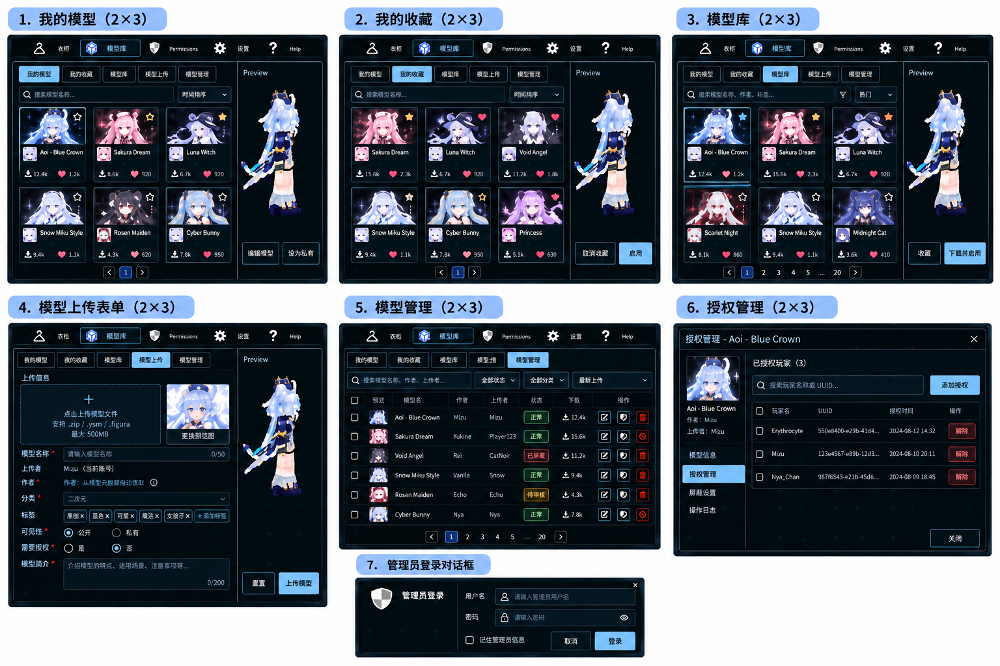

# OmniMorph 模型库开发计划书

状态：待实施。本文只定义开发工作，不代表功能已经实现或测试通过。

调查日期：2026-10-18（Asia/Seoul）。客户端调查基线：`228d16b`；Rust 后端调查基线：`e6355bc`。实施时必须重新核对工作区变化，但不得借此扩大范围。

## 1. 范围与最终需求

在衣柜旁新增模型库 Tab，提供我的模型、我的收藏、公共模型库、模型上传，以及仅管理员可见的模型管理。优先复用 Figura 的原生 UI、解析、渲染、传输及存储能力，仅补充模型库所缺少的业务层。

### 1.1 用户后续确认规则（优先于初始描述和设计图）

1. 预览缓存必须独立：与衣柜、正式下载及启用缓存分开存储、索引、清理和管理生命周期。可以复用解析代码，不能共用缓存实体。
2. 没有上传自定义预览图时，使用仓库根目录的 `ingame_logo.png` 占位。不能改用模型内图标、自动截图或其他缺省图片。自定义预览图损坏/加载失败时也回退到该占位，并提供重试提示。
3. 上传选择仅支持 `.zip`、`.ysm`；必须检查内容，不能凭扩展名确定模型类型。ZIP 可以是 Figura 或 YSM。
4. 模型名称默认从内部元数据自动填入；作者自动提取，不能手填冒充。模型内部名称、完整作者列表、当前上传者通过卡片悬浮提示展示。上传者由后端认证会话确定。
5. 卡片作者默认显示第一个作者，多作者显示“第一位作者 等”；空作者显示“未知作者”。预览图左上角显示 `YSM` / `Figura`。
6. 上传大小上限从后端获取，不能把示意图的 500 MB 写死。现有解析安全预算是另一层约束，见第 5 节。
7. 管理员由后端配置文件设置，包含玩家名、UUID、密码哈希；不新增管理员账户创建/编辑 GUI。
8. 屏蔽模型从所有普通玩家列表隐藏，包括上传者自己的列表和收藏；仅管理员可见。后端强制私有，普通玩家不能改为公开。
9. 私有模型仅上传者本人和管理员可见，不进入公共模型库，不向其他玩家同步展示。授权不能覆盖私有限制。
10. 衣柜自行上传保持现状；若后端核验的哈希命中屏蔽模型，仍允许上传者本人使用，但只对本人可见。不得以复制、换 asset ID 或跨协议请求绕过。

名称输入框默认允许用户调整展示名称；内部原始名称单独保存用于悬浮提示，不被展示名覆盖。此项是为“默认自动填入”确定的实施约定。

### 1.2 参考图与取舍



图片展示信息层级、左右布局、授权管理和登录表单。实施时保持 Figura 当前纹理、按钮、字体、强调色和交互方式，不重建一套网页风格主题。

- 采用自适应网格，不固定为图片中的 2×3。
- 上传格式、大小、封面回退、屏蔽和私有语义全部以 1.1 为准。
- 管理列表可采用参考图的表格式行布局；普通三个列表共用卡片网格。
- 图片中的操作日志页面、批量审核、评分、关注、付费授权、模型编辑器和新认证平台均不在范围内。必要安全审计记录保留在后端，不新增日志管理页面。
- 本计划不升级版本、不重构无关加载/动画系统、不迁移到另一套 Rust 服务、不添加 Qt UI。

## 2. 已调查架构与证据

以下路径相对客户端仓库根目录。表中“已有”仅表示源码存在，不表示本次运行验证通过。

### 2.1 GUI：已有能力和复用边界

Java 源码根路径简称 `J = common/src/main/java/top/aihmc/omnimorph`。

| 已有文件/符号 | 已观察行为 | 本功能用法与边界 |
| --- | --- | --- |
| `J/gui/screens/AbstractPanelScreen.java` | 面板基类，统一 tick、tooltip、面板导航 | 模型库主屏继承；保留返回父屏和原生背景行为 |
| `J/gui/widgets/PanelSelectorWidget.java` | `PANELS` 注册 Profile、Browser、Wardrobe、Permissions、Settings、Help；前两个被索引黑名单隐藏；`PanelIcon` 使用 UV 索引 | 在 Wardrobe 后插入模型库；保持原黑名单含义和现有图标 UV，不因插入新 Tab 改坏其他按钮 |
| `J/gui/screens/WardrobeScreen.java` | 本地 AvatarList、EntityPreview、上传/删除和文件拖放流程 | 保留现状；只复用布局及控件使用方式，不把衣柜列表改造成网络模型库 |
| `J/gui/widgets/lists/AvatarList.java`、`avatar/AvatarWidget.java` | 本地层级行列表；点击调用 `AvatarManager.loadLocalAvatar` | 不能直接拿来作为远端卡片列表，否则点击即装备；复用按钮、选中描边、tooltip 风格 |
| `J/gui/widgets/lists/AbstractList.java` | 滚动条、裁剪区域和容器事件基础 | 新增网格派生类，复用裁剪及滚动；需要自行计算网格行列和可见项 |
| `Button`、`IconButton`、`SearchBar`、`TextField`、`Label`、`SwitchButton`、`ScrollBarWidget` | `J/gui/widgets/` 下已有基础控件 | 搜索、按钮、文本、开关、进度文字、滚动全部组合复用 |
| `J/gui/widgets/EnumButton.java`、`ContextMenu.java` | 枚举按钮配合 ContextMenu 选择项 | 排序、格式、分类、状态筛选复用；不误用 `gui/PopupMenu.java` 的游戏弹出菜单 |
| `J/gui/screens/FiguraConfirmScreen.java` | 删除等确认、取消和 Esc 返回模式 | 直接用于删除确认；复杂登录/授权表单新增专用屏，沿用其父屏和焦点模式，不假称已有通用表单弹窗 |
| `J/gui/widgets/EntityPreview.java` | 实体预览、旋转、拖动、缩放和扩大预览 | 复用交互与渲染路径；它接收 LivingEntity，不是“任意文件预览 API” |
| `J/utils/ui/UIHelper.java` 的 `drawEntity` | 从 `AvatarManager.getAvatar(entity)` 取模型，并创建延迟 GUI 实体渲染状态 | 必须接入隔离的预览实体/模型绑定；不能临时替换本地玩家后立即恢复来伪造隔离 |
| `J/gui/FiguraToast.java`、`widgets/LoadingErrorWidget.java` | 已有通知和加载错误展示 | 复用反馈风格，新业务错误提供本地化键 |
| `common/src/main/resources/assets/omni-morph/lang/{zh_cn,en_us}.json` | 当前中英文资源 | 增量增加模型库文案 |

未发现已接入的远端模型库网格、授权表单、密码表单或模型库管理屏。现有 `TextField` 不等于安全密码输入组件；仅为登录新增遮罩输入适配，不能把密码交给普通 tooltip/narration。

仓库根目录确实存在 `ingame_logo.png`，本次没有查到 GUI 对该文件名的直接引用。实施时把同一图片作为资源打包到 `assets/omni-morph/textures/gui/library_placeholder.png`（新增资源），不要假设根目录图片已经具有 Minecraft 纹理资源 ID。

### 2.2 模型解析、加载、缓存与同步

| 已有文件/流程 | 调查结论 | 复用或最小扩展 |
| --- | --- | --- |
| `J/avatar/local/LocalAvatarFetcher.java` | 本地目录发现；Figura 读取 `avatar.json`，本地图标读取 `avatar.png`；YSM 调用列表元数据解析 | 参考元数据规则；不让每张网络卡片触发磁盘扫描和解密 |
| `J/parsers/AvatarMetadataParser.java` | Metadata 包含 name、author、authors、description 等 | 复用 Figura 元数据解析；作者数组优先，缺失时回退 author |
| `J/avatar/local/LocalAvatarLoader.java` | `compileFiguraAvatar(Path, UUID)` 可编译 Figura；`loadAvatar` 会修改全局 watcher/lastLoadedPath，并通知本地模型 ready | 复用纯编译步骤；预览和上传准备不能调用带全局副作用的入口 |
| `J/avatar/ysm/YsmManifestReader.java` | 支持 `ysm.json`、旧 main.json 元数据；`readListMetadata` 对加密源只返回文件名及空作者 | 上传准备需受预算控制地解析完整 YSM 后取 manifest，不能声称轻量列表读取能读出加密作者 |
| `J/avatar/ysm/YsmModelData.java`、`YsmPackage.java`、`YsmEncryptedSource.java` | 已有目录/ZIP/加密容器解析、资源预算和关闭机制 | 保留原解析器、错误码、加密源边界；不在 Rust 重做 YSM 解密 |
| `J/avatar/ysm/YsmAvatarLoader.java` | `loadAvatar` 解析并发布模型，成功后调用 `NetworkStuff.localAvatarReady` | 复用 `toAvatarNbt` 等准备能力；预览不得直接调用自动广播入口 |
| `J/avatar/AvatarLoadExecutor.java` | 单工作线程、长度 32 的有界任务队列 | 复用重模型准备；卡片缩略图网络任务不占满此队列 |
| `J/avatar/UserData.java` | 异步准备，generation 判旧，主线程 publish | 复用取消与资源清理模式；预览持有独立上下文 |
| `J/avatar/local/CacheAvatarLoader.java` | 哈希 `.nbt` 缓存、七天清理、压缩 NBT，使用 `YsmSourcePayload.forOutput` | 正式下载仍复用；预览不能读写该缓存，也不能通过缓存命中绕过权限 |
| `J/avatar/ysm/YsmSourcePayload.java`、`YsmSourceIdentity.java` | 输出包与运行时内存资源有边界，存在 raw/content/schema 等不同身份 | 保留加密原始载荷；禁止把解密内容写入预览磁盘缓存 |
| `J/backend2/NetworkStuff.java` 的 `localAvatarReady` / `broadcastLocalAvatar` | 当前本地模型准备成功后，压缩上传固定 `avatar` asset，再装备并触发 YSM 快照 | 模型库预览不能触发此流程；正式启用必须保留模型库来源，防止自动重传使 ACL 丢失 |
| `J/backend2/protocol/CloudProtocol.java` | 已有 profile、upload、download、delete、equip、subscribe 等；Metadata 只有模型类型和内容/schema hash | 不存在 catalog/favorites/admin API；扩展单独模型库服务，不能虚构接口已可调用 |
| `ProtobufCloudProtocol.java` | 有 session/epoch、上传 grant、HTTP 文件体、装备状态；equip 校验 owner 为本人 | 不能直接调用 `equip(他人UUID, asset)` 装备公共模型，需后端生成带来源的本人装备引用 |
| `CloudHttp.java`、`CloudEndpoint.java`、`CloudConnection.java` | 端点限制、拒绝重定向、流关闭和连接生命周期；send 内等待 future | 复用传输，但从工作线程调用，不可因底层 sendAsync 就认为主线程不阻塞 |

### 2.3 Rust 后端：当前服务与参考服务的区分

`omnm-cloud/` 是独立 Git 仓库，当前 Cargo 包为 `sculptor`。`src/main.rs` 启动 Axum 0.7/Tokio，挂载 Figura 旧路由、Protobuf 路由及 internal 路由。已使用 rusqlite、serde_json、ring、reqwest、tokio-util，优先复用这些依赖。

`omnm-cloud/spm-cloud/` 则有自己的 Cargo.toml，包为 `spm-cloud`，Axum 0.8；其中 `catalog.rs`、`admin.rs`、`store.rs` 等属于另一套服务。当前 Sculptor Cargo.toml 和启动路由没有接入它。`refs/Sparkle-Morpher/` 的 Cloud 上传界面也不是当前客户端原生组件。两者只可作为有许可证约束的参考，不整套拷贝、不假定其 API 可用、不改它们。

后端源码简称 `R = omnm-cloud/src`。

| 当前实际入口/文件 | 已有能力 | 缺口 |
| --- | --- | --- |
| `R/api/protobuf/mod.rs` | GET `/api/protobuf/v1/capabilities`、POST `/api/protobuf/v1/rpc`、PUT `/api/protobuf/v1/resources/uploads/:operation`、GET `/api/protobuf/v1/resources/:owner/:asset/:revision`、WS `/ws/protobuf/v1` | 无模型列表、收藏、模型 ACL、屏蔽或用户名密码管理员登录 |
| `R/service/session.rs` | Minecraft token 认证，session owner、epoch、有效期、账户预算 | 复用已验证 UUID；管理员需要额外配置密码认证，不能以客户端提交 UUID 为凭据 |
| `R/service/resource.rs` | 上传额度/幂等、临时文件、包检查、原子发布；Figura legacy 导入和下载 | 需要模型库来源/权限检查，以及屏蔽哈希对衣柜分发的限制 |
| `R/api/protobuf/resources.rs` | 下载校验 session 后读取指定资源 | 当前未见模型库 ACL 判断，不能只保护新增列表 API 而放任旧下载地址可读 |
| `R/service/package.rs` | 有限额的分发包身份检查，Rust 不运行/解密 YSM | 只扩展可安全提取的元数据校验，不添加服务器渲染器 |
| `R/storage/mod.rs`、`sqlite.rs`、`layout.rs` | SQLite、不可变 blob、revision、操作幂等、装备、YSM 状态和迁移 | 缺少模型库表、收藏、授权、管理员会话、屏蔽哈希索引 |
| `R/service/equipment.rs`、`event.rs`、`ysm.rs` | 装备变化、双协议通知、YSM 同步 | 需按接收者过滤受限来源，撤权时使旧客户端缓存失效 |
| `R/state/config.rs` 的 `verify_token` | 已有 internal 管理 token 校验 | 不等于本需求的管理员账户/密码登录，不把该 token 发给游戏客户端 |

重要存储约束：`sqlite.rs::save` 会删除并重写 equipment、avatars、owners、operations、ysm_state 等表。新增模型库表不能简单用会级联删除的外键挂到这些重写行上；否则普通衣柜保存会删除库记录。采用独立稳定 model_id、逻辑资源引用及事务一致性校验，详见 6.1。

协议约束：根目录 `protocol/omnimorph/cloud/v1/cloud.proto` 是已冻结的 v1 源；`omnm-cloud/protocol/` 是供应副本，`release.sha256` 有校验。此次优先新增独立模型库 HTTP JSON 扩展，复用现有 session 和二进制传输，不修改冻结字段编号或伪造 release 校验值。

## 3. 权限与可见性：先定义，再实现 UI

### 3.1 状态与身份

- `visibility = PUBLIC | PRIVATE` 与 `requires_authorization: bool` 独立保存。
- `moderation_status = ACTIVE | BLOCKED | DELETED` 独立于上传准备状态。
- 上传者是后端会话 UUID；作者是模型内声明的文本/列表，不能当作所有权证明。
- 管理员必须是配置中 UUID 对应的已验证玩家，并通过配置密码哈希校验；普通 Minecraft 会话本身不授予管理员能力。
- 本计划所有模型库业务读取要求已认证玩家；未登录只显示连接/登录提示，不提供匿名私有资源访问。

### 3.2 未屏蔽、未删除模型的四组合

| 公开性 | 需要授权 | 公共列表与普通卡片信息 | 非上传者完整预览/下载/启用 | 上传者本人 | 管理员 |
| --- | --- | --- | --- | --- | --- |
| PUBLIC | 否 | 已登录玩家可见 | 可用 | 可管理、使用 | 可管理、使用 |
| PUBLIC | 是 | 已登录玩家可见，显示授权锁 | 仅被授权 UUID 可用；未授权仅封面和允许公开的元数据 | 可管理、使用 | 可管理、使用 |
| PRIVATE | 否 | 不可见 | 全部拒绝 | 我的模型可见、可本地使用 | 管理区可见 |
| PRIVATE | 是 | 不可见 | 全部拒绝，包括已有授权 UUID | 可管理授权记录、可本地使用 | 管理区可见 |

私有且需要授权不是“授权后可见”的分享模式：用户已明确私有不向其他玩家展示。授权记录可以保留，重新公开且需要授权时才生效。私有时开关仍可独立修改，不丢失授权意图。公开且不需授权时，授权名单保留但不参与放行判断。

收藏不授予下载权。公开需授权模型允许收藏；变私有后，其他人的收藏记录保留但从列表隐藏，取消收藏的进行中请求仍可按原有引用幂等完成，不得返回私有名称或封面。私有所有者可收藏自己的模型。

### 3.3 屏蔽、解除屏蔽与删除

1. 管理员屏蔽事务同时设置 `BLOCKED`、`PRIVATE`，保留原 `requires_authorization`；创建屏蔽哈希记录，提高策略 revision，写审计记录。
2. 所有普通玩家列表均排除 BLOCKED：公共、我的模型、收藏、搜索结果、总数、推荐候选（本期无推荐功能）和缩略图入口一致处理。旧直链对普通玩家返回不可见结果，不因上传者身份例外返回模型详情。
3. 普通玩家既不能重新公开，也不能借普通 patch 解除屏蔽；并发上传者修改和屏蔽时以策略版本冲突/强制私有为准，不能后写覆盖。
4. 被屏蔽模型通过模型库不能被普通玩家新下载/预览；管理员仅在管理上下文查看和维护。玩家已在本地持有的模型可以自用，衣柜匹配副本只能自见，见 3.4。
5. 解除屏蔽后恢复 ACTIVE，但继续 PRIVATE；上传者显式选择公开后才重新上架。若相同身份仍关联其他有效屏蔽记录，哈希限制继续生效。
6. 删除为逻辑删除，立即撤销列表、资源、缩略图和装备分发。上传者可删除自己的未屏蔽模型，管理员可删除任意模型；不可见的屏蔽记录仅管理员操作。
7. 删除屏蔽记录对应的模型不能自动解除屏蔽哈希，避免“删除后重传”绕过。管理员解除屏蔽是独立明确操作；管理筛选保留可审计的已删除记录。
8. 物理 blob 回收只处理无库 revision、装备绑定和进行中传输引用的文件；使用延迟回收，不删其他模型共享的相同 blob。

### 3.4 衣柜保持现状与哈希屏蔽联动

**现有衣柜上传入口、界面、文件发现和默认广播行为保留；唯一新增分发规则是屏蔽哈希匹配时仅本人可见。** 不自动把衣柜模型刊登到模型库，不强制填写分类/标签/封面。

- 所有上传入口（Figura、Protobuf、internal 写入、历史导入）在可信资源身份建立后查询同一屏蔽哈希索引。
- 匹配后，上传/本地加载仍可成功，后端记录 `distribution_scope = SELF_ONLY`；不向其他玩家提供该资源、对应装备描述、YSM 快照/事件或恢复数据。本人保持模型和本地动作，不必为了屏蔽强制删其本地文件。
- 后端读取时也动态检查，不能仅在上传时检查。管理员后来屏蔽时，已存在的匹配衣柜副本也立即停止新的对外分发。
- 外部观察者收到移除/不可用投影并清除显示；自身会话不接收误清除本人装备的通知。不能只隐藏 Tab 内卡片。
- 哈希使用服务端计算/校验的身份：至少 `raw_sha256`；对可确定的分发内容增加服务端验证的内容身份，以覆盖同包重复上传及压缩封装差异。不能相信客户端任意声明的 content hash。
- `legacy_figura_hash` 是对 Base64 文本的 SHA-256，不能与原始文件 SHA-256 混用；匹配时用明确 hash_kind 和规范化映射。
- 加密 YSM 使用保持密文边界的可靠身份（例如已验证的源密文身份）。不为去重把解密模型上传服务器。
- 本期保证相同且可验证身份的匹配；修改模型内容产生不同身份不属于“同哈希”，不引入感知指纹/相似模型识别。
- 屏蔽与普通私有不同：普通私有约束模型库来源；用户另行持有并通过衣柜上传的非屏蔽资源仍遵循现有衣柜行为。只有屏蔽哈希按用户要求对所有上传来源生效。

### 3.5 后端统一策略入口（新增）

在 `R/service/library_policy.rs` 实现明确的策略函数，输入为已认证主体、操作、模型/资源来源和当前状态，输出允许/拒绝及对该接收者的投影。操作至少包括 discover、metadata、thumbnail、preview_bytes、download、equip、manage、grant、moderate、sync_render。

库引用与衣柜资源都必须在获取字节前调用策略；下载 URL 不是权限证明。私有名称、作者、缩略图、总数和 hash 不泄露给无权主体。状态改变后重新取权限，不能永久信任 DTO 的 can_download。

同步投影需要覆盖 `profile`、HTTP 文件、WS 初次订阅、变更事件、YSM resume/snapshot/delta/event、legacy 临时资源和 compatibility 槽。先鉴权再选 blob，避免已知道 owner/asset/revision 即可取文件。

撤权不能追回已经发出的文件，也无法阻止修改版客户端保留已下载内容。本计划保证官方客户端停止显示/重新启用、服务器停止新的未授权分发；不宣称提供 DRM 或抹除他人磁盘能力。

## 4. 客户端 UI 与状态设计

### 4.1 主屏与自适应网格

新增 `J/gui/screens/ModelLibraryScreen.java`，复用 AbstractPanelScreen。上层导航在衣柜后增加模型库。内部普通按钮作为子页选择：我的模型、我的收藏、模型库、模型上传；只有后端确认有效管理员会话后才增加模型管理。另有小型“管理员登录”入口供配置管理员认证，不能把管理数据提前加载到隐藏控件。

普通列表统一使用新增 `J/gui/widgets/lists/ModelLibraryGrid.java` 和 `J/gui/widgets/library/ModelCardWidget.java`。

- 按 Minecraft GUI 缩放后的逻辑像素布局；左区列表、右区预览，左右比例优先约 70:30，随宽度调整。右区固定保留操作按钮区，模型裁剪在预览区域内。
- 列数 `max(1, floor((可用左区宽度 + gap) / (卡片最小宽度 + gap)))`；卡片实际宽度均分，行数由结果数决定。可见行数由滚动视口高度决定，不与 API 页大小绑定。
- 页大小建议默认 24、后端可限制上限 48；一页可滚动。窗口 resize 只重排，不重新下载、丢选择或重置页码。保存首个可见 model_id 作为滚动锚点。
- 极窄 GUI 仍维持左列表/右预览：一列紧凑卡片、缩窄预览、缩短可见文案并提供 tooltip；操作表单和子页导航可以滚动，不允许按钮移出可交互范围。若物理空间低于项目支持的最小 GUI 尺寸，明确提示调整 GUI scale，不静默重叠。
- 每页只实例化可见卡片和一行预取，滚动裁剪同时约束鼠标命中；键盘方向键移动选择，Tab 到搜索/筛选/分页，Esc 返回父屏。
- 搜索约 300 ms 防抖；筛选或排序变化返回第一页、清空旧分页游标。缩略图回调、搜索结果和预览按请求 generation 处理，旧响应不能覆盖新选择。
- 页按钮为上一页/下一页及页码；采用后端 page/page_size/total，不假装只拿本页数据就有全局排序。排序字段白名单：最新、下载量、收藏量、名称；同值以 model_id 稳定排序。

卡片包含：自定义预览图或 ingame_logo 占位、左上角类型徽标、展示名称、第一作者/“等”、下载量、收藏量、收藏状态及必要的授权锁。完整作者、内部名称、上传者玩家名及 UUID 放在 tooltip。作者和上传者标签不能混淆；UUID 可省略显示但悬浮详情中完整可复制。

### 4.2 子页行为

| 子页 | 数据范围 | 主要操作 |
| --- | --- | --- |
| 我的模型 | 会话 UUID 上传且非 BLOCKED/DELETED | 选择预览、公开/私有、独立授权开关、授权管理、删除；只显示后端允许的操作 |
| 我的收藏 | 本人收藏且当前仍可见 | 相同卡片布局、取消收藏、预览、下载并启用；不可见引用不泄露详情 |
| 模型库 | PUBLIC + ACTIVE | 搜索名称/内部名称/作者/标签，分类/类型/授权条件筛选，排序、分页、收藏、投稿、下载并启用；自己的模型可删除 |
| 模型上传 | 当前草稿 | 选择 ZIP/YSM、自动解析、独立预览、换预览图、分类/标签/简介、公开/私有、是否需要授权、上传进度 |
| 模型管理 | 有效管理员可访问，包括屏蔽/私有 | 名称/作者/上传者查询、类型/分类/状态筛选、删除、屏蔽/解除屏蔽、授权弹窗；复用行列表基类 |

### 4.3 上传表单

- 选文件采用由现有 Button、AbstractList、TextField 组成的轻量文件选择屏，配合现有 Screen 拖放事件；无需新原生文件对话框依赖。仅筛选 `.zip`/`.ysm`，服务端仍验证内容。
- 上传者自动显示认证玩家，不可编辑；作者字段只读。名称自动填入，缺失时以文件名去后缀回退；作者缺失用空数组和“未知作者”，不把上传者伪装成作者。
- 自动元数据解析失败时保持可解释错误；损坏/不支持的模型禁止提交。正常无作者不视为文件损坏。
- 展示名称和简介是用户可编辑的库描述；原始名称及作者来源独立保留。新增字段限长在客户端与服务端一致执行。
- 分类是服务器返回的稳定 ID 列表；标签去首尾空白、去重且限数量；不引入标签推荐服务。
- 预览图为可选图片，支持替换和清除；清除即回退 ingame_logo。无自动截屏步骤；上传准备不因缺图强制运行完整模型。
- 模型预览使用独立缓存/上下文。用户在预览模型时不会改变衣柜选择、实际装备或广播状态。
- 明确阶段：读取元数据 → 本地准备分发包 → 请求上传 → 发送文件 → 后端校验 → 发布；显示发送字节与后端上限，校验期不伪造百分比。失败可重试/取消，不自动重复刊登。
- 屏蔽哈希命中的投稿不能成为普通玩家可见的公共条目；后端可返回受控错误 `MODEL_BLOCKED`，提示仅可通过衣柜本人使用，不展示管理员内部备注。

### 4.4 登录与授权弹窗

新增 `ModelLibraryAdminLoginScreen`：玩家名（登录名）、遮罩密码、记住登录状态、登录、取消。登录必须同时存在当前玩家验证会话，配置 UUID 与会话 UUID 匹配。取消/关闭清理密码；连续失败显示统一错误和冷却，不透露账户是否存在。

“记住登录”只保存可撤销、轮换的 refresh token，不保存密码或密码哈希；令牌绑定服务器 origin/instance、玩家 UUID 和配置版本。凭据文件限制本机用户读写；无法可靠限制访问时禁用跨启动记住功能并解释原因，不能明文保存密码作为降级。

新增 `ModelLibraryAuthorizationScreen`：复用滚动容器展示玩家名、完整 UUID、授权时间及解除按钮；输入玩家名先向后端解析，显示候选玩家名/UUID，再确认添加。唯一身份是 UUID；改名不影响已授权项。私有状态提示“授权保留，私有期间不对其他玩家开放”。普通上传者只能管理自己的未屏蔽模型，管理员可管理任意模型。

## 5. 预览、正式下载和性能边界

### 5.1 独立预览缓存（强制）

新增 `J/model/library/LibraryPreviewSession.java`、`LibraryPreviewCache.java`。建议缓存根为 Figura cache 下 `model-library-preview/`；其下按 server instance、viewer UUID、model_id/revision 分区，并分开 `models/` 和 `thumbnails/`。

- 预览模型和预览缩略图属于独立缓存；不调用 CacheAvatarLoader 的读写，不依赖衣柜文件路径，不以硬链接共享正式缓存。
- 键包含来源、revision、raw hash、策略版本；磁盘命中前仍向后端确认当前权限。私有/需授权/管理员资源响应禁止公共 HTTP cache。
- 预览模型磁盘只存服务器分发包或原始加密载荷，绝不缓存解密 YSM 资源；本地上传草稿的临时数据也在独立目录内处理。
- 默认一次一个重型模型预览，缩略图并发最多 4；缓存容量和 TTL 采用模型库专属预算，例如模型预览 128 MiB、缩略图 32 MiB、24 小时 TTL（实施配置可下调）。单个资源大于缓存预算时不持久化，不无限扩容。
- 退出屏幕、换玩家、换服务器、撤权或删除时取消任务、销毁临时实体和 GPU 纹理；普通 LRU 清理不能删除正在使用文件；启动清理未完成临时文件。
- “下载并启用”重新走正式鉴权和正式下载路径，不从预览缓存复制或提升文件，不因预览成功跳过校验。HTTP 重用连接可以，存储和业务状态不能混用。

### 5.2 预览隔离实现

用独立 UserData/Avatar 准备候选模型，复用 `compileFiguraAvatar`、YSM 解析/转换、AvatarLoadExecutor 和渲染器。为 EntityPreview 的渲染路径新增最窄的预览模型绑定入口，模型绑定只关联独立预览实体/GUI 渲染状态，不改 AvatarManager 的本地玩家条目。

实现必须检查延迟 `GuiEntityRenderState` 消费时机：绑定需持续到本帧实际渲染完成，不能在 extract 后提前 clean。全屏预览也携带同一隔离 session，关闭释放引用。

远端模型默认按现有 Figura 权限系统的受限权限运行；预览不得提升 Lua 网络/文件/输入等权限，不执行自动装备、上传或聊天等副作用。需要动画时通过已有运行时在隔离上下文执行获准部分。若现有渲染入口无法隔离，实施阶段先完成该最小接缝及测试，不使用“先换装再恢复”临时方案。

### 5.3 正式下载并启用

1. 后端按 UUID 再判定可下载和可装备，固定资源 revision 与策略版本。
2. 工作线程流式下载到正式临时文件，校验长度/raw SHA-256，使用现有包解析预算；失败不污染原缓存和现有模型。
3. 解析准备成功后，再调用新增模型库 equip 事务，带 expected equipment revision。后端创建本人装备的资源别名，保留 source_model_id/source_revision，不复制并匿名重传到 `avatar`。
4. 正式缓存复用 CacheAvatarLoader 的序列化和加载能力，另存库来源/权限映射。正式启用通过最小发布入口避开 `localAvatarReady` 的无来源自动上传；仅普通衣柜入口保持原行为。
5. 新装备发布成功后更新 UI；失败保留原模型。服务端提交成功但客户端失联时重查装备，以服务器状态为准，不用新的 operation_id 盲目重复装备。
6. PUBLIC 模型对有权限观察者同步；PRIVATE 仅本人显示；PUBLIC + 需授权只向已授权观察者提供完整模型。未经授权的观察者显示原版/兼容回退，不泄露模型文件。
7. 库来源私有、屏蔽、删除、撤权会使别名策略同步变化。服务器不信任客户端隐藏的 source 标记，别名关系由服务器创建并保存。

### 5.4 上传上限与现有本地预算

后端能力响应返回 `max_upload_bytes`，UI 原样按字节换算显示并在选文件和提交前检查。配置改变导致提交超限时后端拒绝，客户端刷新能力；获取失败不采用 500 MB 等猜测值，禁用新提交并提供重试。

同时调查到 `CloudHttp.FILE_BYTES = 64 MiB`，`YsmResourceLimits.DEFAULT` 为原始文件 64 MiB、单资源 32 MiB、总展开 256 MiB、资源数 4096。它们是已冻结安全预算，不能为了文案一致自动上调。

- 后端声明的是允许上传上限；客户端另报告其可解析能力。若后端上限高于当前解析能力，超过本地安全预算的文件明确提示“当前客户端不支持此大小/展开资源”，而非伪称后端限额更低。
- 文件选择检查输入 ZIP/YSM 长度；最终上传校验实际分发包长度，压缩/封装后也可能超限。两种大小都给出清晰错误。
- 默认本期不放宽冻结安全预算。服务端能力同时返回接受格式、模型类型、图片限制、分页限制及分类；只展示兼容交集，仍以服务器拒绝结果为最终依据。

### 5.5 异步与资源管理

HTTP、分页解析、图片解码、哈希、文件读取和模型编译均不在游戏渲染线程执行。纹理注册/释放、控件状态替换及最后模型发布回到 Minecraft 主线程。现有 CloudHttp 的同步等待只能运行于有界网络任务执行器。

搜索任务取消、请求 generation、服务器 epoch、玩家 UUID 四者共同判旧。列表加载、预览和传输各有状态，不能一项慢任务使整个 UI 失去响应。缩略图按可见项请求且按 revision 合并去重；禁止为 24 张卡片加载 24 个完整模型。

Rust 同步 SQLite、文件校验和密码 KDF 使用有界 blocking 工作路径；不得持有锁跨网络 await。列表用索引/参数化查询，预算覆盖账户并发、速率、请求体、图片像素和展开资源。

## 6. 数据结构与持久化方案（均为拟新增/扩展）

### 6.1 关系与迁移

扩展同一个 Sculptor SQLite 数据库；不引入第二数据库服务。新增库表使用稳定模型 ID 与明确逻辑引用。基础资源 manifest 事务重写时不得删除库表数据。

| 表/记录（拟新增） | 关键字段和约束 |
| --- | --- |
| `library_models` | model_id 主键、uploader_uuid、uploader_name_snapshot、display_name、internal_name、authors_json（有序）、model_type、category_id、description、visibility、requires_authorization、moderation_status、current_revision、policy_revision、created_at、updated_at；CHECK 限枚举；BLOCKED 必须 PRIVATE |
| `library_revisions` | (model_id, revision) 唯一；owner/asset/resource_revision 逻辑引用、raw_sha256、可验证 content identity、byte_length、distribution_format、metadata_source、metadata_validation；可追踪原始文件名但不存客户端完整路径 |
| `library_tags` | (model_id, normalized_tag) 唯一；展示标签另存，限制数量和字符数 |
| `library_images` | model_id、image_revision、hash、媒体类型、尺寸、长度；没有记录即使用客户端 ingame_logo，不为占位创建每模型副本 |
| `library_favorites` | (player_uuid, model_id) 唯一、created_at；收藏操作幂等，统计仅真实插入/删除时更新 |
| `library_grants` | (model_id, player_uuid) 唯一、name_snapshot、granted_by、created_at；权限固定为本期模型使用，不引入自定义角色体系 |
| `library_stats` / `library_download_receipts` | model_id 的下载计数；receipt 绑定玩家、revision、用途、有效期、完成状态；重复确认不重复计数，预览不计下载 |
| `library_resource_bindings` | (resource_owner, asset_id, revision) 唯一，source_model_id/source_revision；支持本人装备别名与统一权限追溯 |
| `library_blocked_hashes` | (hash_kind, verified_hash, blocking_model_id) 唯一、active、理由、操作者、时间；不能因删除库条目自动失效 |
| `library_operations` | (actor_uuid, operation_id) 唯一、请求指纹、结果、有效期；处理模型库跨文件/数据库提交幂等 |
| `library_audit` | actor UUID、动作、对象、时间、结果；不存明文密码、token 或私有模型正文 |
| `library_admin_sessions` | token hash、refresh token hash、UUID、origin/instance 绑定、expiry、config revision、撤销状态；没有管理员密码账户表 |

管理员配置是账户权威来源，不在数据库同步一份可独立编辑的管理员名单。分类和上传/图片/请求预算在后端配置中定义。

索引至少覆盖公开性+状态+更新时间+ID、uploader_uuid、类型/分类、收藏玩家、授权 UUID、hash_kind/hash。搜索第一版采用有界参数化 LIKE 和标签关联，不引入搜索引擎；中文用原文子串、作者完整列表参与查询。返回列表和总数必须使用同一个权限过滤条件。

上传提交先安全发布不可变 blob，再在事务中完成资源描述、库记录、来源映射和操作结果；中断可产生待回收 blob，但不能出现可公开下载的半成品。需要在现有 Storage transaction 边界增加最小事务 hook/专用提交方法，不整体改写存储架构。数据库 schema 升级时处理当前 `user_version > 1` 拒绝逻辑；迁移前备份，失败回滚，不让旧服务误读新库。

### 6.2 元数据可信度

客户端复用现有解析器提供内部名称、作者和类型；服务器对可直接解析的 Figura NBT/公开包元数据及格式进行验证，不能把请求 body 的 uploader_uuid、model_type 或 hash 直接作为权威值。

加密 YSM 的内部作者在客户端受限解码后取得，服务器不解密，标记 `metadata_validation = CLIENT_EXTRACTED`，不能宣称服务端验证作者真实性。权限和资源哈希不能依赖该文本。保留作者顺序，清除空值，避免重复；多作者的“等”由客户端根据数组长度生成。

模型源文件与网络分发包不是同一格式合同：用户选 ZIP/YSM 后，客户端通过现有解析器生成现有 Figura 压缩 NBT / YSM 分发载荷，再复用当前原始 HTTP 传输。不得把 ZIP 文件直接传给只接受压缩 NBT 的现有接口，也不得因为网络分发格式不同而在文件选择器开放额外后缀。保留必要原始元数据到库记录，用户自定义展示名不反写模型原始作者。

允许展示元数据只作为纯文本：长度有界，不解释任意点击链接/格式命令，不把模型字符串用于文件名、SQL 或 URL 拼接。

### 6.3 管理员配置草案

在 `omnm-cloud/Config.example.toml` 记录以下**新配置形状**，并在 `R/state/config.rs` 增加解析。真实密码哈希只由部署者写入实际配置，禁止提交真实凭据。

```toml
[[model_library.admins]]
player_name = "ExampleAdmin"
uuid = "00000000-0000-0000-0000-000000000001"
password_hash = "<versioned-kdf-parameters-salt-hash>"
```

利用已有 ring 的 PBKDF2-HMAC-SHA256 实现版本化哈希校验和恒定时间验证；工作因子、随机盐、最小值/最大值必须验证，KDF 不跑在异步 reactor 线程。部署文档提供离线生成哈希方法（必要时增加小型后端工具），不把明文密码写入命令行历史或日志。格式及测试向量在阶段 M1 冻结，不接受裸 SHA-256 作为密码哈希。

玩家名用于输入匹配/显示，UUID 决定身份；改名后管理员可更新配置中的名字，UUID 不变。重复 UUID、重复规范化登录名、非法 UUID、弱/未知哈希格式使对应配置无效并明确报错，不能回退成无密码管理员。配置加载时构建版本指纹；支持现有配置重载入口时同步撤销受影响会话，否则明确要求重启生效，不能假称已有热更新。

## 7. API 合同草案

### 7.1 扩展策略

以下 `/api/library/v1/...` 路由**全部是计划新增**，当前代码没有这些 API。采用 JSON 控制请求和普通 HTTP 二进制文件体；继续使用同一后端 origin、已验证 token/session、CloudHttp 的端点及预算控制。

Protobuf 模式复用现有 Bearer session + `x-omnimorph-epoch` 的身份解析；Figura 模式由 library 适配器复用已验证的 Figura token，再调用同一业务服务。请求头语义由服务器明确解析，拒绝同时携带冲突身份。两种模式均不在 URL 中放 token。

新客户端单独探测 library capabilities；旧服务器返回 404/不支持时模型库显示“后端未提供模型库”，衣柜继续可用。不在缺能力时尝试调用 spm-cloud API 或自动切换后端。

| 方法及拟新增路径 | 输入/输出与权限 |
| --- | --- |
| GET `/api/library/v1/capabilities` | 返回 enabled、版本、max_upload_bytes、格式、图片/分页预算、分类、管理员登录可用性；只含非敏感配置 |
| GET `/api/library/v1/session` | 当前玩家 UUID/名称、管理员会话有效性；作为 UI 能力提示，非授权替代 |
| GET `/api/library/v1/models` | scope=public/mine/favorites/admin，q、category、tags、type、authorization、status、sort、page、page_size；返回 items、total、page、has_next；admin scope 强鉴权 |
| GET `/api/library/v1/models/{id}` | 当前可见详情、版本和 permissions；不可见统一 404 |
| PATCH `/api/library/v1/models/{id}` | 展示名/简介/分类/标签、visibility、requires_authorization、expected_revision、operation_id；本人/管理员，普通人不能改 moderation 或 uploader |
| DELETE `/api/library/v1/models/{id}` | expected_revision、operation_id；本人可见模型/管理员，幂等逻辑删除 |
| PUT / DELETE `/api/library/v1/models/{id}/favorite` | 本人收藏状态；PUT 要求可见；DELETE 允许清理本人持有的已不可见引用且不返回详情 |
| POST `/api/library/v1/uploads` | 草稿元数据+最终分发描述+operation_id；创建不可公开的 pending model，返回 model_id、上传 operation、同源相对传输路径及期限 |
| POST `/api/library/v1/uploads/{operation}/commit` | 校验最终 hash/长度、元数据、可选图片已就绪；原子发布，重复请求返回同一模型结果 |
| DELETE `/api/library/v1/uploads/{operation}` | 取消本人的未提交草稿/清理暂存，已提交则返回明确状态 |
| PUT / DELETE `/api/library/v1/models/{id}/image` | 本人/管理员，限额图片流或清除；后端检查签名、像素/长度，与模型 revision/草稿绑定 |
| GET `/api/library/v1/models/{id}/image` | 权限检查后返回自定义图；不存在返回受控无图状态，客户端使用 ingame_logo |
| POST `/api/library/v1/models/{id}/transfers` | purpose=preview/download，固定 revision，服务端判权限；返回短期 transfer_id 和同源路径，preview 不计数 |
| GET `/api/library/v1/transfers/{transfer_id}` | 普通 HTTP 文件体；每次请求重验主体/用途/策略/期限，不能只验持有 ID |
| POST `/api/library/v1/transfers/{transfer_id}/complete` | 客户端完成哈希验证后的 receipt；仅 download、字节发送已结束、有效且未计数时累计一次 |
| POST `/api/library/v1/models/{id}/equip` | 本人下载已准备、expected_equipment_revision、model_revision、operation_id；再授权并创建带来源的本人资源别名；返回现有装备状态的 JSON 投影 |
| GET `/api/library/v1/models/{id}/grants` | 本人/管理员，分页返回玩家名、UUID、授权时间 |
| PUT / DELETE `/api/library/v1/models/{id}/grants/{uuid}` | 本人/管理员，UUID 唯一键、operation_id；不能通过 body 改 uploader |
| GET `/api/library/v1/players/resolve?name=...` | 本人/管理员在授权操作中使用；查询可信已认证玩家资料，返回候选 UUID、玩家名；限流、拒绝歧义 |
| POST `/api/library/v1/admin/login` | 当前玩家会话+玩家名+密码+remember；配置 UUID 必须匹配；返回短期 admin token/可选 refresh token |
| POST `/api/library/v1/admin/refresh` | 单次轮换 refresh token，重查配置 UUID/权限；旧 token 重用撤销 token family |
| POST `/api/library/v1/admin/logout` | 撤销本人管理员会话与持久刷新凭据 |
| PUT / DELETE `/api/library/v1/admin/models/{id}/block` | 管理员屏蔽/解除屏蔽，expected_revision、operation_id、理由；屏蔽强制私有，解除后仍私有 |

上传二进制尽量复用现有 `/api/protobuf/v1/resources/uploads/:operation` 的流处理及 Transfers；Figura library 适配器若无 scoped session，新增薄的 library 上传路由转到同一实现，不复制第二套落盘算法。pending 来源绑定必须在 grant 发出前建立，旧 DownloadRequest、CommitUpload、Delete、Equip 也须识别该来源；不允许普通旧 RPC 提前发布/装备 pending 库资源。

### 7.2 请求和结果模型

`ModelSummary` 至少包含 model_id、revision、policy_revision、display_name、internal_name、authors[]、uploader{uuid,name}、model_type、image_revision/image_available、下载/收藏计数、favorited、visibility、requires_authorization、allowed_actions。列表不带完整包、不带管理员密码字段、不带私有预览 URL。

`ModelDetail` 在可见前提下增加简介、分类、标签、长度、更新日期和资源 revision。作者 tooltip 来自同一摘要，无需悬浮时再加载完整模型。客户端长整型处理计数/长度，禁止溢出。

所有更改使用 operation_id；涉及并发覆盖时还要求 expected_revision。相同 id+相同请求幂等返回，相同 id+不同请求报冲突。收藏唯一键同样提供幂等。

列表响应必须适配现有 CloudHttp 64 KiB 控制响应预算。M0 为展示名、内部名称、作者条数/字节、标签及摘要总字节冻结限额；后端根据摘要最大序列化长度确定可支持的固定 page_size 上限，在 capabilities 返回并用于整个查询的页偏移计算。不得逐页临时缩短 page_size 导致漏项，也不得在客户端静默截断 JSON。简介不放列表摘要；全文在详情按同一受控预算返回。动态计数排序允许刷新后页内容变化，客户端显示最新结果，不承诺跨多个请求的静态快照。

错误 JSON 包含稳定 code、localization_key、request_id、retryable；可带不敏感的当前限额/重试秒数。401 重新认证、403 可见但无操作权、404 不可见/不存在、409 冲突需刷新、413 超限、415 格式不支持、429 冷却、503 后端忙。错误不回显路径、密码、token 或私有元数据。

玩家名解析第一版使用后端已验证玩家目录；没有唯一可靠记录则要求目标玩家先连接该后端，不用名字计算离线 UUID，也不根据输入任意请求外部 URL。未来支持外部身份查询属于另行范围，不阻塞本期的已注册玩家授权。

### 7.3 下载统计口径

仅“正式下载”完成字节发送并收到客户端哈希确认后计一次；同 transfer 重试不增量，预览、封面、权限失败和中断不计数。建议同玩家/模型 revision 在 24 小时窗口内去重以限制刷量，口径显示在部署文档中。

统计是使用趋势，不是授权依据，也不能证明恶意客户端实际持久化了文件。计数通过事务/唯一约束维护；取消收藏只减实际存在的一条记录，避免负数和多次点击漂移。

## 8. 分阶段执行计划

以下所有阶段均为**尚未执行**。不得把本次计划书提交视为下列开发阶段通过。依赖顺序固定：M0 → M1 → M2 → M3 → M4 → M5 → M6 → M7。

### 8.1 通用执行与提交门禁

每阶段开始核对 AGENTS.md、Git 状态和涉及文件；若仍有 `.codegraph/`，先用 CodeGraph 查询符号。只修改该阶段列出的必要范围；发现无关问题记录后续项。不可改 refs 或 spm-cloud 来“补齐架构”。

每阶段完成后：更新本节状态/验证记录 → 检查 git status/diff → 格式化本阶段代码 → `git diff --check` → 提交 → 推送当前分支 → 确认推送成功 → 才进入下一阶段。

客户端和 `omnm-cloud` 是两个独立仓库；分别提交/推送自己负责的文件，并在进度记录写双方 commit ID。不要把嵌套仓库或既有 build.log、refs 当作本阶段附件提交。跨仓库阶段须两边检查点完成后再推进；推送失败可以排查，但不能在未记录状态时开始下一阶段。

所有未来构建/测试在前台 PowerShell 执行，不启动后台构建，不压制 stdout/stderr，采用：

```powershell
& <实际构建或测试命令> 2>&1 | Tee-Object -FilePath "build.log"
$buildExitCode = $LASTEXITCODE
if ($buildExitCode -ne 0) {
    Get-Content -LiteralPath "build.log" -Tail 120
    exit $buildExitCode
}
```

每条命令单独记录退出码并读取失败日志；Java 按项目约定 `usejdk 25`。新测试任务须先在构建文件注册，再写入执行记录，不能把下述建议名字当成已有任务。当前已有的 `:common:networkProtocolSmokeTest`、`:common:cloudAdapterSmokeTest`、`:common:cloudUploadProgressSmokeTest`、`:common:cloudProtocolConfigSmokeTest`、`:common:cloudEndpointSmokeTest` 可用作相关回归入口；涉及真实 native/GUI 的任务须先检查运行约束。

真实界面验证必须启动 Windows 上实际 Minecraft 窗口，等待稳定渲染、交互、截图检查、记录并关闭。本项目当前 GUI 是 Minecraft，并非 Qt；若辅助工具涉及 Qt，同样禁止 offscreen。不能以 mock 控件/隐藏 framebuffer 截图证明真实界面通过。无法执行的手工项标记 `MANUAL/PENDING`，非阻断手工项不妨碍阶段提交；最终交付不能把其写成 PASS。

### M0：合同、数据样例和现有路径核对

**涉及文件**：本计划书；后续新增 `omnm-cloud/docs/MODEL_LIBRARY_API.md`、必要的脱敏 fixture 清单；读取第 2 节相关源文件，不开发 UI。

**任务**：冻结第 3 节权限矩阵、私有同步语义、屏蔽哈希种类、文件格式、元数据顺序、JSON DTO 和错误；核对所有旧读写/订阅入口；确定 Figura/YSM 各样例、实际包元数据来源和最小 GUI 尺寸。明确管理员配置哈希格式和记住登录存储策略。

**验收**：每个操作都有主体、状态、来源和策略结果；明文/加密 YSM 元数据可信边界明确；没有依赖尚未接入的 spm-cloud API；没有以预览缓存替代正式缓存。

**验证方法**：静态逐项映射路由与合同、审阅 JSON 示例、记录样例哈希；本阶段为合同文档工作，无需编译/GUI 自动化。所有合同问题解决或标明不影响本期的后续项后提交推送。

### M1：存储、配置、权限与屏蔽哈希底座

**修改文件**：`R/storage/{mod,sqlite}.rs`、`R/state/config.rs`、`omnm-cloud/Config.example.toml`。

**新增文件（建议）**：`R/storage/library.rs`、`R/service/library_policy.rs`、`R/service/library_admin.rs`、相应 Rust 测试模块；必要哈希生成工具及部署说明。

**任务**：建立表/索引/迁移；管理员配置与安全 KDF；集中四组合权限；屏蔽强制私有、持久哈希索引、幂等/策略版本；事务 hook 避免 manifest save 误删库记录；配置管理员增删/改密的会话撤销规则。

**验收**：四组合×本人/授权者/非授权者/管理员×ACTIVE/BLOCKED/DELETED 全覆盖；屏蔽对上传者列表也隐藏；私有授权者仍不可见；普通资源保存不破坏库表；迁移失败不破坏旧数据；无真实密码进入仓库。

**测试方法**：Rust 临时 SQLite 单元测试、迁移/回滚/重启、并发收藏/授权唯一键、密码正确/错误/坏参数/改配置用例。以 scoped `cargo test` 执行新增模块及现有 storage 回归，按前台日志模板记录。

### M2：后端列表、上传、收藏、授权及管理 API

**修改文件**：`R/main.rs`、`R/api/mod.rs`、`R/service/mod.rs`、`R/service/resource.rs`、`R/service/package.rs`、`R/api/protobuf/{http,resources}.rs`，仅为共用鉴权/传输接缝的必要修改。

**新增文件（建议）**：`R/api/library/{mod,models,uploads,admin}.rs`、`R/service/library.rs` 及 API 集成测试；更新后端 API/部署文档。

**任务**：实现第 7 节除装备/同步完成闭环以外的路由；后端上限返回、可信 UUID 解析、封面流处理、上传 reserve/commit/cancel、事务发布、收藏统计、管理员会话、屏蔽和授权操作。新增路径复用现有资源传输，pending 库资源不可从旧 RPC 绕过。

**验收**：分页/搜索/总数只包含可见记录；无封面时正确返回缺图状态；上传多次重试不创建重复模型；超限和不支持格式早拒绝；伪造 uploader UUID、绕过管理员、猜资源路径失败；管理员配置登录能得到受限会话。

**测试方法**：真实 Axum 测试服务+临时数据库/文件目录，覆盖成功/401/403/404/409/413/429、损坏包、断流、取消、重启、提交竞争、过期 token；检查旧资源直链不能读 pending/私有/屏蔽库数据。禁止用正在部署的真实数据测试删除。

### M3：来源装备、双协议鉴权与衣柜屏蔽联动

**修改文件**：`R/storage/{mod,library}.rs`、`R/service/{resource,equipment,event,ysm,library_policy}.rs`、`R/api/protobuf/{http,resources,subscription,websocket}.rs`、`R/api/figura/profile.rs`、`R/api/figura/websocket/`、`R/api/lambda/internal.rs` 及必要 legacy 入口。客户端必要接缝限 `J/backend2/NetworkStuff.java`、`J/backend2/protocol/`、`J/avatar/AvatarManager.java`。

**任务**：实现模型库 equip 和来源别名；按接收者过滤 profile/资源/订阅/YSM 恢复；权限变更使旧观察者显示失效；所有衣柜上传/历史导入命中屏蔽 hash 时 SELF_ONLY。客户端增加正式库模型发布入口，不能匿名重传；普通衣柜保持原 API 行为。

**验收**：同一屏蔽包换 UUID/asset、不同传输协议及历史资源直链仍仅各自本人可用；未匹配衣柜模型行为不变；私有模型从不向其他玩家展示；公开授权模型的未授权观察者不能取完整模型；旧协议兼容槽不泄露 YSM 或受限 Figura；管理员屏蔽不会清掉本人本地自用模型。

**测试方法**：上传者 A、授权玩家 B、无权玩家 C 和管理员 D 的多会话 API/WS 测试；在上传后屏蔽、下载中撤权、已经订阅后变私有、断线 resume、后端重启进行覆盖。重用 `R/api/protobuf/tests/legacy_bridge.rs` 等旧双协议回归和 Java CloudAdapter 测试框架。不能把只验证卡片隐藏视为通过。

### M4：客户端异步服务、独立预览与正式下载基础

**新增文件（建议）**：`J/backend2/library/{LibraryClient,LibraryModels,LibrarySession}.java`、`J/model/library/{LibraryPreviewSession,LibraryPreviewCache,LibraryTransferService,LibraryMetadataReader}.java`。

**修改文件**：`J/backend2/protocol/{CloudProtocol,ProtobufCloudProtocol,FiguraCloudProtocol}.java`（最小能力适配）、`J/gui/widgets/EntityPreview.java`、`J/utils/ui/UIHelper.java`、必要的 `J/avatar/{UserData,AvatarManager}.java` 与加载器纯准备入口；`common/build.gradle` 仅注册新测试任务。

**任务**：实现 DTO、能力探测、后台查询、取消/epoch 判旧；预览隔离绑定与独立缓存；ZIP/YSM 元数据准备；正式下载哈希校验及来源装备；图片异步解码/GPU 线程边界。不得改全局动画算法或整体重写加载器。

**验收**：选卡片/取消/换页/预览不触发任何 upload/equip，也不改变衣柜选中项；预览文件与正式缓存不同目录且无相互读取；点击正式下载确实调用正式授权/下载；加密资源无解密磁盘副本；后台失败保留当前装备；切换服务器/玩家旧响应无效。

**测试方法**：新增有界任务、请求取消、缓存路径/清理、竞态发布和假 HTTP 服务测试；结合 Figura、YSM 明文/加密真实 fixture；真实游戏窗口中检查预览渲染及关闭资源释放，记录 pending 的人工项。

### M5：模型库主屏、自适应卡片和三个列表

**新增文件**：`J/gui/screens/ModelLibraryScreen.java`、`J/gui/widgets/lists/ModelLibraryGrid.java`、`J/gui/widgets/library/ModelCardWidget.java`。

**修改文件**：`PanelSelectorWidget.java`、中英语言文件；新增最小 Tab 图标资源和从根图片复制的 `textures/gui/library_placeholder.png`，不改已有纹理 UV。

**任务**：衣柜旁 Tab、子页按钮、网格/滚动/页码、搜索/筛选/排序、右预览；卡片类型徽标、作者首位+等、完整 tooltip；收藏/取消、下载并启用、本人删除/公开私有入口；空/加载/离线/错误态。

**验收**：不同分辨率出现 1/2/3/更多列且不固定 2×3；长中文和多作者可读；无图统一 ingame_logo；卡片总数/页码随后端数据；缩放/resize 不丢选择；屏蔽条目不留在客户端旧页；非管理员看不到管理子页。

**测试方法**：布局纯计算和事件命中测试；真实窗口在 1280×720、1920×1080、2560×1440 与项目支持的多个 GUI scale 下检查。每种代表状态保留必要截图，检查中文无方块、焦点/滚动/遮挡、先后返回的搜索结果。

### M6：上传、授权和管理员交互闭环

**新增文件（建议）**：`J/gui/screens/library/{ModelUploadScreen,ModelFilePickerScreen,ModelLibraryAuthorizationScreen,ModelLibraryAdminLoginScreen,ModelLibraryManagementScreen}.java` 及必要密码字段适配。

**修改文件**：M4 服务、M5 页面入口、中英资源；后端仅修补已定义合同缺口。

**任务**：ZIP/YSM 选择/拖放、自动元数据、上传者只读、后端限额、换图/清图、独立选项、进度取消重试；UUID 授权管理；配置管理员登录、记住/退出；管理员搜索/筛选/屏蔽/解除/删除。

**验收**：不要求手填作者；ZIP 内容识别正确；后端上限改变后提交刷新；私有和授权开关互不重置；取消弹窗不执行变更；配置 UUID 不匹配无法登录；屏蔽后所有普通列表刷新隐藏、服务器强制私有；解除屏蔽不自动公开。

**测试方法**：上传成功、元数据缺失/非法、超限、坏图、断网、token 过期、服务器错误、重复提交；授权玩家改名与歧义；登录成功/失败/限流/改配置/refresh 重用；真实窗口核对进度、中文 tooltip、密码不泄露和弹窗焦点。

### M7：完整回归、性能、安全与交付

**涉及文件**：新增测试、测试 fixture 清单、后端部署说明、本计划进度记录；生产代码仅修复本期验收缺陷。

**任务**：执行第 9、10 节矩阵；验证数据库升级/备份恢复、旧客户端/旧后端降级、两协议衣柜回归、模型库启用和撤权、独立缓存清理；记录性能数据和剩余手工项。

**验收**：所有阻断自动检查通过；第 10 节逐条提供结果/证据，不能用未运行的项目填 PASS。若 UI 手工项仍 pending，只能报告功能开发检查点完成且人工待验，不能称完整视觉验收完成。预定检查全部满足即结束，不追加无关重构/功能。

**测试方法**：实际客户端+后端联调、Rust 集成测试、适配器与协议冻结回归；前台构建目标按当前 enabled_platforms 选择，不假定所有 loader 都可运行。基于原有分辨率/同一硬件作有无模型库对比，不宣称固定 FPS。窗口资源压力测试采用有限批次并关闭窗口/释放模型。

### 8.2 进度记录模板

| 阶段 | 状态 | 自动验证/退出码 | 手工验证 | 客户端 commit/push | 后端 commit/push |
| --- | --- | --- | --- | --- | --- |
| M0 | NOT_STARTED | — | — | — | — |
| M1 | NOT_STARTED | — | — | — | — |
| M2 | NOT_STARTED | — | — | — | — |
| M3 | NOT_STARTED | — | — | — | — |
| M4 | NOT_STARTED | — | — | — | — |
| M5 | NOT_STARTED | — | — | — | — |
| M6 | NOT_STARTED | — | — | — | — |
| M7 | NOT_STARTED | — | — | — | — |

## 9. 安全、兼容性、异常与性能验收方案

### 9.1 安全测试矩阵

- 对每个路由测试无会话、伪造 UUID、跨账户操作、过期 session/epoch、配置管理员 UUID 不匹配；不能只测 UI 按钮禁用。
- 遍历四组合、屏蔽、解除屏蔽、删除及授权变化；同时测列表、total、详情、图片、文件、预览、equip、profile、两协议 WS 和恢复接口。
- 直接访问旧资源 URL、猜 transfer、复用已撤权 grant、断流重试、跨协议上传、使用旧缓存重新装备必须遵循同一策略。
- ZIP 路径穿越、绝对路径、符号链接、重复危险条目、压缩炸弹、过多资源、非法 NBT、损坏/伪装扩展名均拒绝；继承现有 YSM 预算，不先无界展开再校验。
- 图片签名、格式、尺寸/像素及解压后内存预算均检查；图片不是可执行内容，禁止 SVG/HTML 任意外链。Rust 若现有依赖无法安全实现必要图片检查，只增加最小专用依赖并说明原因，不引入图像服务。
- SQL 参数化，排序字段白名单；名称/标签文本限长，不把 metadata 当 HTML/脚本/可执行 Minecraft click event。
- HTTPS 和现有端点信任规则继续生效，禁止跨域重定向携带凭据；登录、密码 KDF、上传和解析都有预算。
- 密码/token 不进日志、截图、崩溃错误或 narration；配置样例不含真实 UUID/密码哈希；审计日志只有必要身份和动作信息。

### 9.2 兼容性测试矩阵

| 组合 | 预期 |
| --- | --- |
| 新客户端 + 无 library 扩展的后端 | 模型库显示不支持，衣柜仍按原模式工作 |
| 旧客户端 + 新后端 | 原衣柜功能不变；命中屏蔽 hash 后外部看不到，本人仍可用 |
| Figura/Protobuf 切换 | 凭据与任务失效正确，库状态以后端为准；不自动切换协议绕权 |
| Figura ZIP / YSM ZIP / 加密 .ysm | 自动类型和元数据正确；模型加载、材质、动画保持原解析能力 |
| Figura compatibility 槽 | 无权限内容不投影，YSM 不伪装成 Figura 返回 |
| 普通衣柜模型 | 非屏蔽哈希保持上传、切换、同步及清理行为 |
| 模型库来源的私有/需授权资源 | 不因保存到本人装备别名、缓存命中或自动广播丢失来源权限 |
| 管理员屏蔽后的既有缓存/订阅者 | 后续服务器访问失败，官方客户端清除外部显示；本人衣柜模型继续自用 |

### 9.3 异常处理

列表错误保留当前筛选和可安全保留的结果，标记过期并提供重试；权限错误立即清除敏感结果，不能为“离线体验”继续展示其他人的私有内容。搜索零结果与网络失败明确区分。

模型下载写 `.part`，验 hash 后原子落正式路径；失败删除临时文件，保留旧模型。上传断网保留表单草稿，但不持久化密码；重试使用同 operation_id 查询/提交。服务器重启丢失内存上传 grant 时明确重新申请，不把客户端进度当已发布。

库资源 policy_revision 改变时取消排队任务，正在传输的流在可行的检查点停止；已发出的字节无法追回。正式启用重新鉴权。图片失败只影响封面，解析失败只影响该模型，不崩溃整页。

管理员会话失效立即退出管理页、清理敏感缓存；普通玩家会话仍可使用普通功能。配置管理员被删除/改密后 refresh 失败，不能沿用旧长期 token。

### 9.4 性能与可观测性

- 先验证硬条件：渲染线程无网络等待、解包、哈希和数据库操作；完整模型只加载当前选中项；有界并发/队列/缓存；关闭后资源数回落。
- 以 10,000 条库元数据、48 条分页上限、长中文作者/标题进行服务端分页测试；查询不返回全量再客户端过滤，索引使用有记录。
- 人工连续搜索/换页/resize/选模型 50 次后检查无旧回调覆盖、无持续线程/句柄/GPU 纹理增长；重型模型采用小批次测试，不无限压力循环。
- 记录列表 API、缩略图、首次预览/缓存预览、正式下载、主线程帧耗时、内存峰值。初始性能门槛为无 UI 冻结、无无限增长、预算可控；具体延迟基于同硬件/样例基线制定并记录，不伪造未测数值。
- 服务端记录 request_id、状态码、耗时、字节数、拒绝原因类别；客户端日志不要记录敏感模型内容或凭据。

## 10. 最终完整验收清单

所有项在实施验收时填写 PASS / FAIL / MANUAL/PENDING 及证据；以下目前均未执行。

### UI 与交互

- [ ] 衣柜旁存在模型库 Tab，原有 Tab、快捷入口和衣柜无回归。
- [ ] 三个普通列表采用同一自适应网格，滚动、搜索、过滤、排序、分页和 resize 正确。
- [ ] 自定义预览图正常；缺图/清图统一显示 ingame_logo，不自动截图、不以模型图标代替封面。
- [ ] 类型徽标来自真实解析；ZIP 不被一律判为 Figura。
- [ ] 卡片显示名称、第一作者/“等”、下载/收藏量；tooltip 含内部名称、全部作者和上传者。
- [ ] 中文、长文本、空状态、错误、键盘焦点和多个 GUI scale 的真实窗口已检查。
- [ ] 管理子页仅有效管理员可见，普通用户不预取管理数据。

### 上传、预览、下载

- [ ] 仅 ZIP/YSM，内容校验、自动名称/作者、上传者只读、分类/标签/简介正确。
- [ ] 最大上传大小由后端取得；加载失败、动态变化、最终包超限和本地安全预算冲突均有明确提示。
- [ ] 可选预览图替换/删除、公开性和授权开关独立生效。
- [ ] 上传进度、取消、断网重试、提交幂等和后台校验完整。
- [ ] 预览独立缓存/实体/生命周期，不读取正式缓存、不改装备、不广播。
- [ ] 加密 YSM 无解密内容落盘；解析器、渲染器、现有资源预算得到复用。
- [ ] 下载并启用走正式下载鉴权/缓存流程，失败保留原装备；正式启用保留服务器来源绑定。
- [ ] 收藏唯一、取消幂等、预览不计下载、下载重试不刷计数。

### 权限与管理

- [ ] 四组合符合第 3 节，私有模型不向任何其他普通玩家展示，授权名单不能覆盖私有。
- [ ] 屏蔽后所有普通列表隐藏（包括上传者），后端强制私有且普通玩家不可改公开。
- [ ] 解除屏蔽仍保持私有；删除屏蔽模型不会清掉屏蔽哈希约束。
- [ ] 未屏蔽衣柜上传保持原样；匹配屏蔽 hash 的上传及历史副本只对各自本人可见。
- [ ] 两协议、旧下载路径、临时槽、compatibility 槽、WS/恢复数据均不能绕过策略。
- [ ] 授权以 UUID 生效；添加名字先解析确认；玩家改名不丢授权、歧义不误授权。
- [ ] 管理员来自配置玩家名/UUID/密码哈希；登录绑定已认证 UUID；无额外管理员创建 GUI。
- [ ] 记住登录不存密码，令牌可撤销/轮换；配置变更、失效、登出清理正确。
- [ ] 管理员可搜索、筛选、删除、屏蔽/解除、管理授权，普通用户伪造请求被后端拒绝。

### 工程交付

- [ ] 上传 reserve/commit 及来源映射原子可靠；重启、备份、升级/回滚可验证。
- [ ] 旧 manifest save 不清空模型库数据，blob 回收不破坏共享资源。
- [ ] 旧客户端/旧后端、Figura/YSM、衣柜/模型同步回归有证据。
- [ ] 无渲染线程阻塞、无无界列表/图片/模型队列，无退出后资源持续增长。
- [ ] 所有改动符合现有格式，diff 范围检查和 git diff --check 通过。
- [ ] 每阶段分别记录并完成提交推送；不混入 build.log、refs、凭据和无关工作区修改。
- [ ] 未通过/未运行项如实标记，真实 GUI 结果不能由 offscreen 替代。
- [ ] 未新增范围外功能或无关重构，项目版本不自动升级。

## 11. 本次计划书交付记录

本次只调查源码、查看参考图、编写本 Markdown 并复制参考图片。未开发功能、未修改生产代码、未执行编译或测试。提交范围仅本文件与 `docs/MODEL_LIBRARY_UI_REFERENCE.png`；工作区已有 `build.log` 和嵌套目录保持原状。

实施前必须关注的已识别风险：延迟 GUI 渲染中的预览绑定生命周期、旧下载路由绕过 ACL、自动广播丢失模型库来源、SQLite manifest 重写与库表关联、屏蔽哈希跨协议身份一致性。它们已纳入对应阶段，不作为额外无关重构理由。
